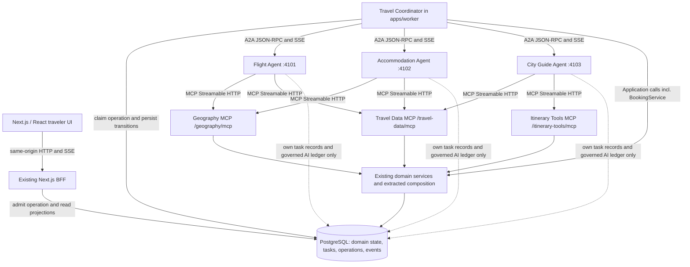
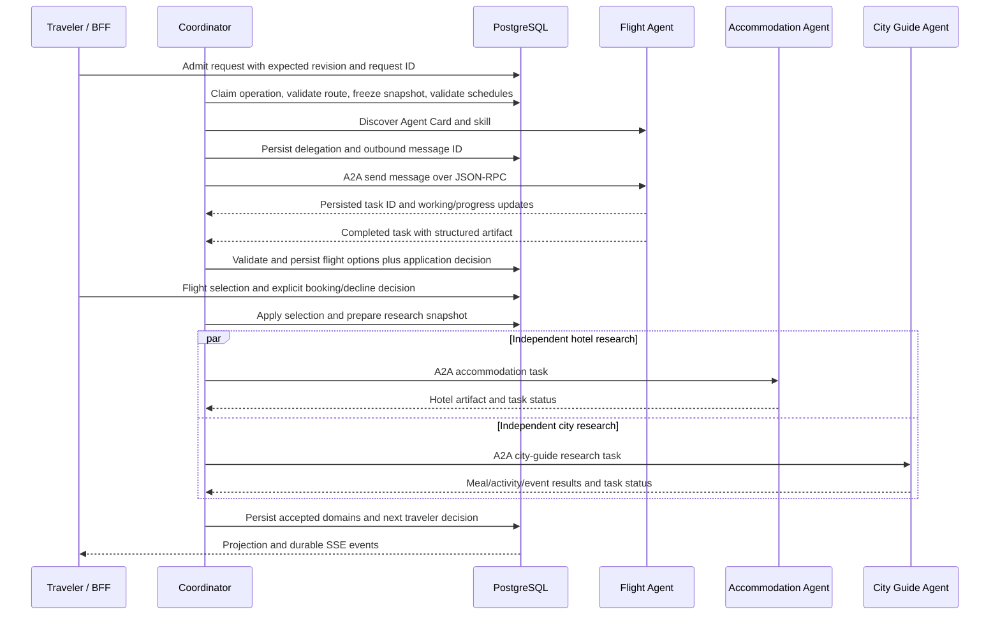
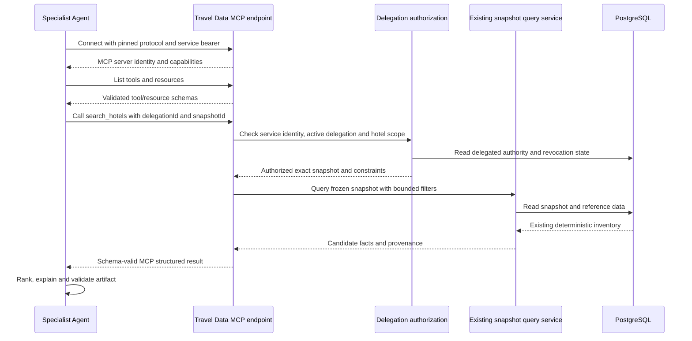
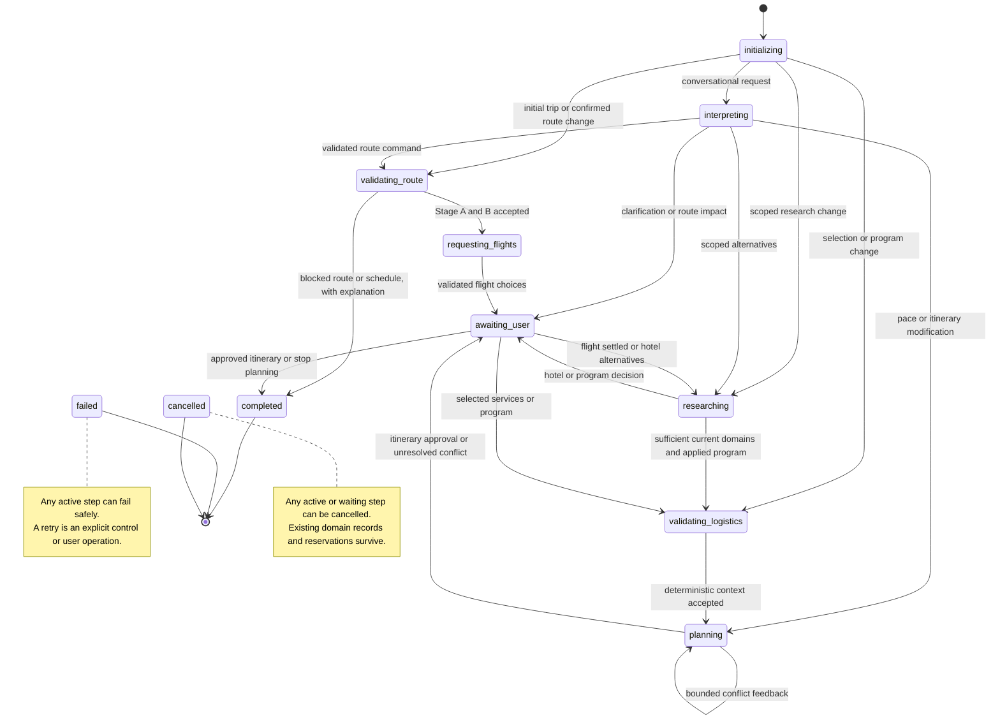
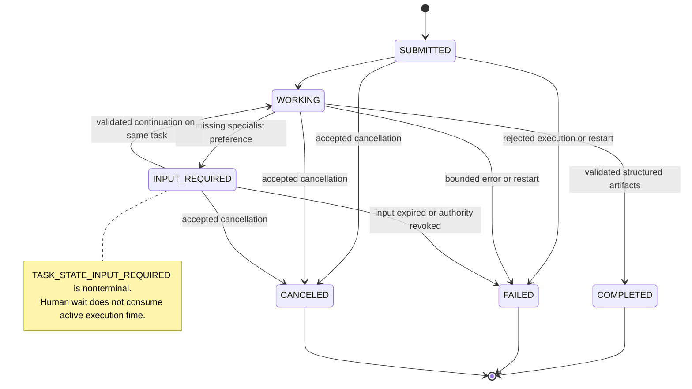
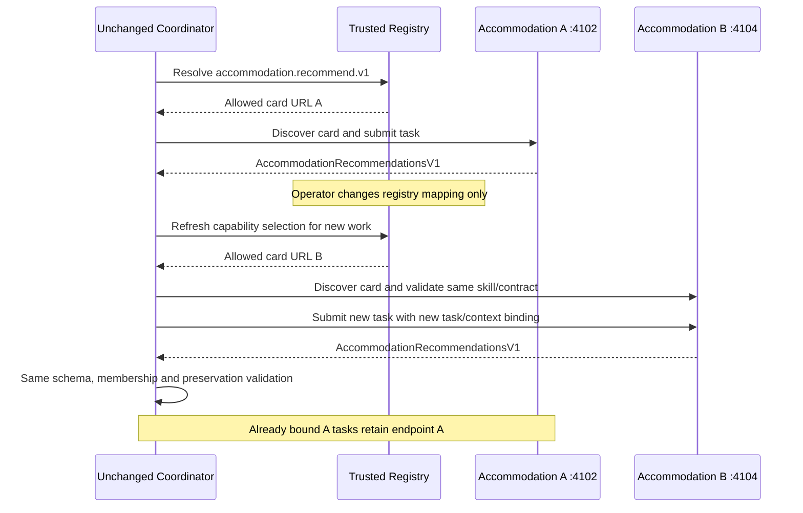

# AI Travel Planner — MCP/A2A Migration Plan

**Planning date:** 2026-10-16  
**Audited commit:** `4a0f94a41a6fb3808b1bb77fbb20ca883c89831c`  
**Scope:** Repository-specific architecture and implementation roadmap. The migration is not implemented
by this document.

This plan replaces LangGraph orchestration incrementally, preserves the existing application and domain
rules, and introduces genuine A2A specialists and MCP services. It makes the decisions needed for
implementation rather than leaving service boundaries, state ownership, recovery, or protocol versions
to the implementation agent.

**Existing-trip policy:** Trips created by the previous LangGraph runtime remain readable history after
cutover. They cannot be resumed or modified. Preserve their scenario snapshots, selections,
reservations, conversation, and other domain records. Do not translate LangGraph checkpoints into
coordinator state. New planning starts as a new trip.

## 1. Existing architecture and verified baseline

### 1.1 Repository findings

The repository is an existing, functional TypeScript npm-workspace monorepo. Keep its `apps/*` and
`packages/*` layout. A new repository layout or application rewrite would add migration risk without
improving the protocol demonstration.

| Area                     | Actual implementation                                                           | Migration consequence                                                                          |
| ------------------------ | ------------------------------------------------------------------------------- | ---------------------------------------------------------------------------------------------- |
| Runtime                  | Node.js 24, PostgreSQL 17, private ESM workspace packages                       | Keep the runtime and database.                                                                 |
| Frontend/BFF             | `apps/web`, Next.js 16 and React 19                                             | Preserve the application, pages, wizard, styling, maps, chat, and voice controls.              |
| Background execution     | `apps/worker`, a dedicated Node process with no public HTTP port                | Turn this process into the Travel Coordinator; do not add a public coordinator HTTP service.   |
| Orchestration            | `packages/workflow/src/travel/graph.ts`, `travel-graph-v7`, 29 registered nodes | Replace graph execution with explicit application-specific dispatch.                           |
| Business rules           | `packages/domain`                                                               | Preserve deterministic rules and the booking authority.                                        |
| Reference/synthetic data | `packages/data` and `packages/persistence/src/{reference,scenario}`             | Preserve reference admission, seeded generation, immutable snapshots, and content hashes.      |
| Persistence              | `packages/persistence`, schema `odft_app`, plus `odft_checkpoint`               | Reuse application persistence; add coordinator/protocol state separately.                      |
| AI                       | `packages/ai` and `apps/worker/src/ai/service.ts`                               | Preserve fixture/OpenRouter adapters, structured roles, model validation, and cost governance. |
| Browser updates          | BFF projections plus database-backed SSE                                        | Keep this boundary. The browser already does not consume LangGraph streams directly.           |
| Human interaction        | Application decisions bound to graph execution metadata                         | Keep decision semantics and remove their dependence on graph interrupts.                       |
| Research                 | Six domains: hotel, breakfast, lunch, dinner, attractions, events               | Split execution between Accommodation and City Guide; preserve per-domain results and gates.   |
| Infrastructure           | `compose.yaml` runs PostgreSQL                                                  | Add npm-managed service processes; no broker, Redis, or additional database is needed.         |

The current system already owns substantial durability outside LangGraph: operation admission,
revision checks, leases, fencing, effects, decisions, reservations, events, and conversation. Reuse
these mechanisms. The migration must replace graph-specific execution state without discarding the
application's existing consistency model.

### 1.2 Verification recorded during the repository audit

These results were obtained at the audited commit earlier in this planning session. They are evidence
about the current implementation, not evidence that the proposed architecture has been implemented.
The documentation write does not rerun these suites.

| Check                                              | Recorded result                        | Limitation                                                  |
| -------------------------------------------------- | -------------------------------------- | ----------------------------------------------------------- |
| Unit tests                                         | 542 passed in 59 files; 17.92 seconds  | Existing implementation only.                               |
| Integration tests                                  | 197 passed in 47 files; 593.87 seconds | Used an isolated, guarded `_test` database.                 |
| TypeScript                                         | Passed                                 | Existing implementation only.                               |
| ESLint                                             | Passed                                 | Existing implementation only.                               |
| Production build                                   | Passed                                 | Five existing Turbopack filesystem-tracing warnings remain. |
| Built exports/browser verification                 | Passed; 26 browser chunks checked      | Existing server/browser boundary checks.                    |
| Playwright discovery                               | 92 tests in 12 files                   | Tests were listed, not executed during this audit.          |
| Controlled completion, latency, and cost benchmark | Not established                        | Phase 01 must produce this baseline.                        |

The five build warnings concern dynamic filesystem access in AI configuration, speech configuration,
and country-policy loading. Do not describe the build as warning-free. No live paid model calls were
made during the audit. Historical application database rows mix manual and test traffic; they are not
a controlled completion-rate, latency, or cost benchmark.

### 1.3 Invariants that all phases must preserve

The active project memory is `agent-memory/active-context.md`, `agent-memory/invariants.md`, and
`agent-memory/architecture.md`. The code remains the source of truth when older planning documents
differ from it.

1. Stage A route validation and Stage B schedule validation remain deterministic. A persisted,
   fingerprint-bound feasible-route approval is required before flight generation and booking.
   Prague to České Budějovice must fail before any flight scenario is generated.
2. Keep airport eligibility, destination catchments, reference-version binding, real time zones, DST,
   connection constraints, sightseeing windows, and variant-specific arrival/departure dates.
3. Synthetic data are reproducible for their scenario identity and versions. Keep separate Faker
   streams and independent domain hashes. An MCP read never regenerates inventory.
4. `BookingService` is the sole reservation writer. Preserve explicit demonstration consent,
   `DEMO-*` references, effect replay, offer membership checks, and one confirmed reservation per
   service. Replacement requires explicit confirmation.
5. Flight and hotel booking are optional. Declining a booking retains the selected offer as usable
   planning context and includes its cost. Preserve self-arranged meals/activities and opt-in visits.
6. Accepted command/chat requests, including `set_simulation` and `retry_failed_domains`, increment
   `trip.revision` once. Decision responses, including `agent_input`, create a new operation at the
   unchanged current revision. Worker progress, automatic retries, owner technical retry,
   cancellation controls, protocol events and artifact ingestion do not increment it.
7. A trip has one authoritative execution writer. Claims rotate fencing tokens; leases last 60 seconds
   and renew every 15 seconds. Keep the per-trip advisory lock and default worker concurrency of two.
8. Network calls must not execute inside database transactions or an existing `runEffect` callback.
   Keep transactions short and acquire at most one connection per independent research task.
9. Persist source fingerprints and validate current revision, scope, snapshot, allowed IDs, and
   reservation preservation before accepting any asynchronous result.
10. Preserve session ownership, exact Origin validation, CSRF, request deduplication, rate limits,
    safe error envelopes, and database-backed SSE replay.
11. Reuse governed LLM roles and the per-trip call/cost limits. Unknown paid-call outcomes remain
    reserved; a timeout must not turn an uncertain charge into zero.
12. Preserve the effective three-attempt itinerary loop and review repetition policy. A higher
    configured limit does not authorize more attempts than the current implementation allows.
13. Voice remains optional, uses same-origin VAD assets, retains its dedicated transcription key and
    separate USD ledger, and submits ordinary application commands.
14. Optional Wikidata landmark curation remains default-off and occurs before snapshot creation. It
    is not an MCP tool side effect; existing snapshots remain unchanged.

## 2. Migration inventory and feature parity

### 2.1 Classification and destination map

`KEEP` preserves behavior and location. `EXTRACT` moves reusable composition behind a stable local
service. `ADAPT` changes integration while retaining responsibility. `REPLACE` substitutes a new
execution mechanism. `REMOVE` applies only after replacement tests pass and final cutover occurs.
Paths marked **new** are implementation destinations, not files created by this planning task.

| Existing module/path                                                                                                                             | Classification    | Current dependencies/responsibility                                                 | Target and rationale                                                                                                                    |
| ------------------------------------------------------------------------------------------------------------------------------------------------ | ----------------- | ----------------------------------------------------------------------------------- | --------------------------------------------------------------------------------------------------------------------------------------- |
| `apps/web/src/app/{page.tsx,trips}`                                                                                                              | KEEP / ADAPT      | BFF projections, traveler navigation, wizard and trip pages                         | Same paths; adapt execution/status fields and add historical-trip rendering.                                                            |
| `apps/web/src/components/{wizard,offers,booking,preferences,program,itinerary,map}`                                                              | KEEP              | Public contracts, UI-safe helpers                                                   | Keep components; replace graph-specific conditions only.                                                                                |
| `apps/web/src/components/assistant`                                                                                                              | KEEP / ADAPT      | Chat, clarification, route-impact approval, voice                                   | Keep conversation behavior and add specialist input rendering.                                                                          |
| `apps/web/src/app/api/trips`                                                                                                                     | ADAPT             | Admission, commands, decisions, operations, events, voice                           | Preserve public request contracts where possible; dispatch according to trip engine and enforce history restrictions.                   |
| `apps/web/src/lib/{session,guard,rate-limit,http,request}.ts`                                                                                    | KEEP              | Anonymous session and HTTP security                                                 | No protocol credentials or arbitrary agent endpoints in browser-facing code.                                                            |
| `apps/web/src/lib/{projection,use-trip-projection,use-sse,operation-preloader}.ts`                                                               | ADAPT             | Persisted domain/event projections                                                  | Add coordinator/protocol status and replay-safe events; retain projection ownership.                                                    |
| `apps/web/src/components/inspector/{InspectorView,execution-graph}.tsx`                                                                          | REPLACE           | Graph topology and execution events                                                 | **New** `communication-map.tsx` and protocol timeline; retain useful safe event/cost panels.                                            |
| `apps/web/src/components/inspector/execution-graph-layout.ts`                                                                                    | REMOVE / EXTRACT  | Layout of LangGraph nodes/edges                                                     | Remove graph layout; reuse generic positioning helpers only if independently useful.                                                    |
| `apps/web/src/lib/{voice-*,use-assistant-voice}.ts` and voice API routes                                                                         | KEEP / ADAPT      | STT/TTS, VAD, voice ledger, same command path                                       | Keep architecture; block voice writes on historical trips.                                                                              |
| `apps/worker/src/{main,worker,claim,lease,shutdown,trip-lock}.ts`                                                                                | ADAPT             | Queue polling, pools, heartbeat, locking, shutdown                                  | Keep worker process as coordinator; remove saver/guard pools once graph execution is removed.                                           |
| `apps/worker/src/driver.ts`                                                                                                                      | REPLACE           | `PostgresSaver`, graph invocation, streaming, graph finalization                    | Application coordinator driver calling `packages/workflow/src/coordinator/dispatch.ts` (**new**).                                       |
| `apps/worker/src/checkpointer/fenced-saver.ts`                                                                                                   | REMOVE            | LangGraph checkpoint write fencing                                                  | Remove at final cutover; retain operation fencing for application writes.                                                               |
| `apps/worker/src/travel/ports.ts`                                                                                                                | EXTRACT           | Domain services, persistence, provider composition, AI access                       | **New** `packages/services/src/travel/{context,scenario,research,booking,itinerary}.ts`; temporary graph adapter remains until cutover. |
| `apps/worker/src/travel/itinerary-review.ts`                                                                                                     | EXTRACT           | Review policy around AI reviewer/domain findings                                    | **New** `packages/services/src/travel/itinerary-review.ts`; preserve current bounded policy.                                            |
| `apps/worker/src/travel/landmark-discovery.ts`                                                                                                   | EXTRACT           | Optional pre-snapshot Wikidata curation                                             | **New** `packages/services/src/travel/landmark-discovery.ts`; coordinator-only maintenance capability.                                  |
| `apps/worker/src/ai/service.ts`                                                                                                                  | EXTRACT / ADAPT   | Governed adapters, role contexts, ledger, worker fencing                            | **New** `packages/services/src/ai/{runtime,authority}.ts`; add delegated task authority without exposing coordinator tokens.            |
| `packages/workflow/src/travel/{graph,runtime,state,graph-definition,start-input,ports}.ts`                                                       | REPLACE / REMOVE  | StateGraph, annotations, graph version, routers, graph ports                        | **New** `packages/workflow/src/coordinator`; retain package name to avoid unnecessary workspace moves.                                  |
| `packages/workflow/src/nodes`                                                                                                                    | EXTRACT / REPLACE | Mixture of reusable rules and graph returns/interrupts                              | Pure functions/services move to services/domain; coordination steps move to coordinator handlers.                                       |
| `packages/workflow/src/{harness,state/research-reducer,invocation}`                                                                              | REMOVE / ADAPT    | Test graph, reducers, checkpoint invocation reconciliation                          | Replace with coordinator tests, persisted per-domain aggregation, and application reconciliation.                                       |
| `packages/workflow/src/routing/{invalidation-matrix,next-work-target}.ts`                                                                        | ADAPT             | Command-to-domain/work routing using domain matrix                                  | Keep deterministic rules; return coordinator work targets rather than graph node destinations.                                          |
| `packages/domain/src/{preferences,commands,dates,fingerprints}.ts`                                                                               | KEEP              | Preference inheritance, command validation, dates, canonical hashes                 | Same paths; no SDK imports.                                                                                                             |
| `packages/domain/src/booking`                                                                                                                    | KEEP              | Pure booking service over `BookingStore`                                            | Same authority; coordinator invokes it only after persisted application approval.                                                       |
| `packages/domain/src/research` and `packages/domain/src/selective`                                                                               | KEEP / ADAPT      | Ranking, affected domains, exact retries, preservation/fingerprint scopes           | Reuse for delegation scope and artifact acceptance.                                                                                     |
| `packages/domain/src/itinerary`                                                                                                                  | KEEP              | Assembly, cost/time arithmetic, pace, validation, approval                          | Shared deterministic service; City Guide returns proposals rather than replacing these rules.                                           |
| `packages/data/src/reference`, `data/reference`, `data/manifests`                                                                                | KEEP              | Offline geographic reference and coverage/licensing                                 | MCP queries wrap existing lookups; no runtime reference download.                                                                       |
| `packages/data/src/{feasibility,synthetic,providers,routing}`                                                                                    | KEEP              | Deterministic route/schedule checks, simulation, provider results, travel estimates | Use local services and read-only MCP adapters over frozen snapshots.                                                                    |
| `packages/persistence/src/scenario/research-domains.ts`                                                                                          | EXTRACT / ADAPT   | Currently reads the active snapshot and writes artifacts and fault outcomes         | Split explicit-snapshot queries from fenced writes; it cannot be mounted as a read-only MCP API unchanged.                              |
| `packages/persistence/src/scenario/{snapshots,flight-materialization,trip-services,route-inputs,validations,faults}.ts`                          | KEEP / ADAPT      | Scenario creation/extension, route data, approvals, fault controls                  | Coordinator owns writes; add explicit delegated-snapshot readers.                                                                       |
| `packages/persistence/src/{booking-store,reservations,proposals,self-arranged,itineraries,recommendations}.ts`                                   | KEEP / ADAPT      | Authoritative domain records                                                        | Preserve schemas and invariants; only trusted application services write these records.                                                 |
| `packages/persistence/src/{admission,trip-commands,trips,decisions,effects,operations}.ts` and `operations/*`                                    | ADAPT             | Request dedupe, revision, decisions, effect ledger, claims and fences               | Add engine/coordinator state and atomic transitions; remove checkpoint-dependent finalization at cutover.                               |
| `packages/persistence/src/{events,inspector,conversations,llm-calls,voice-calls,usd}.ts`                                                         | KEEP / ADAPT      | Durable events, safe projections, conversation, cost ledgers                        | Extend correlation and delegated budget checks without duplicating ledgers.                                                             |
| `packages/persistence/src/{checkpointer-setup,readiness}.ts`                                                                                     | REMOVE / ADAPT    | Saver setup and readiness check for `odft_checkpoint`                               | Remove saver setup; readiness checks coordinator/protocol migrations and service reachability as appropriate.                           |
| `packages/persistence/migrations/0001-*.sql` through `0012-voice.sql`                                                                            | KEEP              | Versioned, checksummed migration history                                            | Never rewrite applied migrations; append `0013`, `0014`, then final-cutover `0015`.                                                     |
| `packages/contracts/src/{commands,preferences,booking,scenario,feasibility,itinerary,voice}.ts`                                                  | KEEP / ADAPT      | SDK-independent Zod contracts                                                       | Add compatible fields only where required; no transport SDK types in browser contracts.                                                 |
| `packages/contracts/src/{decisions,operations,projection,inspector,errors,enums}.ts`                                                             | ADAPT             | Public decisions and graph-coupled execution DTOs                                   | Add coordinator execution, `agent_input`, safe protocol DTOs and history capability fields.                                             |
| `packages/contracts/src/graph-definition.ts`                                                                                                     | REMOVE            | Browser-safe LangGraph topology                                                     | Replace with `packages/contracts/src/protocol-observations.ts` (**new**).                                                               |
| `packages/ai/src/{adapter,fixture-adapter,openrouter-adapter,config,capabilities,costs,semantic}.ts`                                             | KEEP              | LLM provider abstraction and governance                                             | Reuse with separate specialist profiles and compact contexts.                                                                           |
| `packages/ai/src/context/role-contexts.ts` and recommendation role/prompt                                                                        | ADAPT             | Recommendation context currently covers hotels/meals/activities, not flights        | Add explicit flight context, fixture support, and `recommendation-v2.ts` (**new**); do not invent a new provider layer.                 |
| `packages/ai/src/{speech-*,*-speech-adapter}.ts`                                                                                                 | KEEP              | Separate speech configuration, adapters, pricing                                    | Keep voice governance and credential separation.                                                                                        |
| `scripts/{db-migrate,reference-load,import-reference,ai-validate-models,voice-validate-models,voice-vad-assets,verify-build,setup-local-env}.ts` | KEEP / ADAPT      | Maintenance, configuration, compiled-package and client-bundle verification         | Add new workspaces/services to setup/build verification; preserve explicit reference maintenance.                                       |
| `scripts/checkpointer-setup.ts`                                                                                                                  | REMOVE            | Graph saver initialization                                                          | Remove only when all active execution uses the coordinator.                                                                             |
| `tests/{unit,integration,e2e}`                                                                                                                   | KEEP / ADAPT      | Domain, BFF, graph, worker, voice, browser regression                               | Preserve meaningful behavioral assertions; replace graph-only mechanics with coordinator/protocol coverage.                             |
| `package.json`, `package-lock.json`, workspace manifests, TypeScript configs                                                                     | ADAPT             | Build order, workspace exports, graph/AI dependencies                               | Add selected protocol packages and new workspaces; remove LangGraph packages after verified cutover.                                    |
| `README.md`, `.env.example`, `compose.yaml`, existing `docs/planning`                                                                            | ADAPT             | Setup and old architecture descriptions                                             | Document service processes, trust boundaries, limits, and historical status of old graph design.                                        |

Before removal, search imports and configuration for `@langchain/langgraph`, its checkpoint packages,
`@langchain/core`, `StateGraph`, annotations/reducers, `Command`, `Send`, `interrupt`, `PostgresSaver`,
`odft_checkpoint`, and graph-specific environment/setup references. Remove LangChain packages only
after confirming no preserved AI abstraction requires them. A historical text or applied migration is
not active runtime orchestration.

### 2.2 Replacement of the actual 29-node workflow

| Current node(s)                                                       | Preserved behavior                                                               | Coordinator replacement                                                                           |
| --------------------------------------------------------------------- | -------------------------------------------------------------------------------- | ------------------------------------------------------------------------------------------------- |
| `load_context`, `apply_commands`                                      | Load authoritative domain state; validate and atomically apply accepted commands | Initialization and command application using application services.                                |
| `interpret_intent`, `resolve_clarification`, `interpret_modification` | Typed intent, clarification, preserve constraints, command validation            | Coordinator conversation handler using the existing intent role.                                  |
| `detect_progress`                                                     | Determine next unsettled traveler decision                                       | Deterministic progress resolver; declined flight/hotel booking counts as settled.                 |
| `validate_route`, `generate_flights`, `validate_schedules`            | Stage A, deterministic snapshot materialization, Stage B                         | Coordinator preparation before Flight A2A delegation; never delegated generation authority.       |
| `ensure_domains`                                                      | Extend the scenario for required research domains                                | Idempotent coordinator scenario preparation; revalidate Stage B for the active extended snapshot. |
| `dispatch_research`, `research_domain`, `join_research`               | Parallel affected-domain work, exact bounded retry, necessary-domain gate        | Persisted Accommodation/City Guide delegations and per-domain result aggregation.                 |
| `rank_recommendations`                                                | Binding deterministic rank, optional safe AI reorder                             | Agent ranking plus coordinator membership/category validation and persisted accepted artifact.    |
| `validate_selected_logistics`                                         | Validate selected flights/hotel/meals and airport/hotel constraints              | Coordinator deterministic local service.                                                          |
| `plan_itinerary`, `validate_itinerary`, `review_itinerary`            | Bounded proposal/assembly/validation/review loop                                 | City Guide `itinerary.propose.v1` plus coordinator deterministic validation/review acceptance.    |
| `approve_itinerary`                                                   | Explicit approval of the bound persisted draft                                   | Existing application decision resolved by coordinator.                                            |
| `prepare_decision`, `await_decision`, `apply_decision`                | One pending decision, fingerprint binding, allowed response                      | Atomic persisted application decision and saved coordinator cursor; no graph interrupt.           |
| `stage_command_proposal`, `stage_selection`                           | Stage allowed offer/proposal without silent replacement                          | Application services with existing proposal/effect rules.                                         |
| `commit_booking`, `decline_booking`                                   | Explicit demo booking or retain selected unbooked offer                          | Existing BookingService calls and recovery of cursor advancement.                                 |
| `commit_route_change`                                                 | Apply confirmed route impact and invalidate incompatible records                 | Existing atomic route-change service under coordinator fencing.                                   |
| `apply_program`                                                       | Meal choices, self-arranged values, opt-in activities/preferences                | Existing command/program service and deterministic logistics validation.                          |
| `publish_summary`                                                     | Publish completed, blocked, or failed outcome and safe explanation               | Persisted coordinator finalization and BFF projection.                                            |

### 2.3 Feature parity matrix

| Feature                                                                            | Source of current behavior                                           | Target implementation and required proof                                                                                |
| ---------------------------------------------------------------------------------- | -------------------------------------------------------------------- | ----------------------------------------------------------------------------------------------------------------------- |
| First name, sightseeing date, origin airport, country/city, party, optional budget | Wizard; contracts/preferences; trip admission                        | Keep UI/contracts; API and browser round trip with ownership and date-window checks.                                    |
| Economy / one night and Comfortable / two nights                                   | `domain/src/dates.ts`, synthetic flights/hotels, schedule validation | Same D-1/D/D+1 semantics; both variants in domain, integration, and E2E cases.                                          |
| Budget / Standard / Luxury inheritance and hotel/meal overrides                    | `domain/src/preferences.ts`, selective matrix                        | Exact `override ?? default`; changing defaults never silently replaces a confirmed choice.                              |
| Relaxed / Moderate / Intensive pace                                                | Itinerary assembly, transfer allowance, metrics/validation           | Same meal durations, transfer buffers, breaks, density and visit budgets.                                               |
| European geography and airport compatibility                                       | Reference policy/repository, catchments, Stage A                     | Preserve full admitted coverage, destination-airport limits and timezone evidence.                                      |
| Unrealistic route rejection                                                        | Stage A and persisted approval guard                                 | PRG to České Budějovice yields an explanation and no generated flights or agent workaround.                             |
| Schedule/timezone/DST feasibility                                                  | Stage B and itinerary validators                                     | Validate both flight directions, local sightseeing windows, connections and airport buffers.                            |
| Flight options and explanations                                                    | Synthetic flight provider and flight decision                        | Flight Agent reads only Stage-B-valid offers through MCP and returns ranked structured candidates.                      |
| Hotel options and location/date fit                                                | Accommodation provider, recommendation artifacts                     | Accommodation Agent via MCP; same dates, party/category and selected-flight constraints.                                |
| Breakfast/lunch/dinner and service-specific categories                             | Meal provider, program choices, restaurant booking                   | City Guide via MCP; preserve optional dinner and self-arranged meals.                                                   |
| Culture, landmarks, relaxation, entertainment, events                              | Reference/synthetic activities, interests and program choices        | City Guide preserves available categories, reference provenance, opt-in visits and event nonblocking behavior.          |
| Optional Wikidata landmark enrichment                                              | Worker landmark service and reference persistence                    | Default-off coordinator pre-snapshot step; no network dependency in deterministic tests.                                |
| Itinerary assembly, validation, review, approval                                   | `domain/src/itinerary`, planner/reviewer roles                       | City Guide proposes; deterministic code owns times, money, membership and final acceptance; maximum three attempts.     |
| Cheaper hotel / keep flights                                                       | Intent, bound-category search objective, preservation guards         | Accommodation-only refresh; existing flight/reservation IDs and unrelated meals remain stable.                          |
| More museums / less exhausting day                                                 | Intent, interests/requirements, pace routing                         | City Guide refresh/proposal only where required; preserve applied program and confirmed bookings.                       |
| Luxury dinner / reduce budget                                                      | Per-service override, budget command, invalidation matrix            | Scope refresh exactly; budget warning/alternatives do not silently mutate reservations.                                 |
| Flight/origin/destination/date/variant changes                                     | Route-impact proposal and command batching                           | Show persisted impact, require confirmation, revalidate route/snapshots and affected reservations; party remains creation-only. |
| Simulated flights/hotel/restaurant reservations                                    | BookingService, booking store, effects, references                   | Same explicit demo disclaimer, idempotency and replacement uniqueness; no external booking/payment integrations.        |
| Declined booking / later booking                                                   | `decline_booking`, persisted selection, late booking flow            | Selected offer stays in itinerary/cost; later explicit booking follows ordinary proposal/confirmation.                  |
| Anonymous sessions and ownership                                                   | BFF session/guard/admission                                          | Same protections on all existing and new routes, including cancellation and inspector.                                  |
| Chat, clarification, modifications during pending decisions                        | Conversation rail, intent service, persisted decisions               | Same validated command path; obsolete decisions/delegations cannot apply late results.                                  |
| Voice input/output                                                                 | Voice routes, VAD, speech adapters and ledger                        | Same UX and command admission, optional feature flag, limits, dedicated STT key and separate cost display.              |
| Browser refresh, close/reopen, SSE replay                                          | Database events, projection, decimal event cursor                    | Keep durable replay/deduplication; add real A2A/MCP observations.                                                       |
| Retry, fault injection, partial research                                           | Admitted simulation/domain-retry commands, technical retry controls | Preserve their distinct revision rules, exact failed scopes and completed siblings; mark simulated faults clearly.     |
| Developer inspector                                                                | Safe graph/event/AI/voice projection                                 | Replace topology with distinct A2A, MCP and Application communication and timing.                                       |
| Existing trips                                                                     | Domain records and historical graph events                           | Read-only history after cutover, including safe conversation/reservations; no resume, command, booking or voice writes. |

## 3. Target architecture and implementation decisions

### 3.1 Processes and package boundaries

| Process               | Location                                 | Local endpoint                 | Responsibility                                                                                                                 |
| --------------------- | ---------------------------------------- | ------------------------------ | ------------------------------------------------------------------------------------------------------------------------------ |
| Web/BFF               | `apps/web`                               | Existing configured web origin | Traveler UI, authenticated BFF, request admission, projections and database SSE.                                               |
| Travel Coordinator    | Existing `apps/worker`                   | No public HTTP port            | Poll operations, interpret requests, prepare scenarios, delegate, validate results, manage decisions and authoritative writes. |
| Flight Agent          | `apps/flight-agent` (**new**)            | `127.0.0.1:4101`               | Independent A2A flight recommendation executor.                                                                                |
| Accommodation Agent A | `apps/accommodation-agent` (**new**)     | `127.0.0.1:4102`               | Independent A2A hotel recommendation executor.                                                                                 |
| City Guide Agent      | `apps/city-guide-agent` (**new**)        | `127.0.0.1:4103`               | Independent A2A city research and itinerary proposal executor.                                                                 |
| Accommodation Agent B | `apps/accommodation-agent-alt` (**new**) | `127.0.0.1:4104`               | Separate compatible executor for the replacement demonstration; optional in normal startup.                                    |
| MCP host              | `apps/mcp-server` (**new**)              | `127.0.0.1:4200`               | Hosts three distinct MCP server identities at `/geography/mcp`, `/travel-data/mcp`, `/itinerary-tools/mcp`.                    |
| PostgreSQL            | Existing `compose.yaml` service          | Existing DB configuration      | Application state, protocol tasks, delegations, ledgers and safe observations.                                                 |

City Guide owns itinerary proposals because its candidates, meal preferences, interests, and pace are
already the inputs to the planner. A fourth itinerary service would add a network boundary with little
independent responsibility. Its research and itinerary skills remain separate contracts and budgets.

One MCP process is sufficient for the POC. Each endpoint creates its own MCP server, identity,
capabilities, tool/resource inventory, authorization policy, and client connection. This demonstrates
separate capabilities without introducing three operationally redundant processes. The boundaries
allow later physical separation without changing contracts.

Add two private ESM packages:

- `packages/services`: local application composition extracted from worker ports and the governed AI
  service. It uses contracts, domain, data, AI and persistence. It contains no A2A/MCP wire types.
- `packages/protocols`: official SDK adapters, trusted registry/client construction, task persistence,
  deduplication, delegated authorization and sanitized telemetry. It uses contracts and persistence;
  it does not implement business rules or import coordinator handlers.

Keep `packages/workflow`, replacing its internals with typed coordinator dispatch. Dependencies flow
from the coordinator toward services/protocol clients, and from agent applications toward services
and protocol adapters. There is no import of another agent's executor. Public contracts stay
SDK-independent. All workspace consumers use built ESM exports, with TypeScript project references
and production-resolution checks.



### 3.2 Selected SDKs and transports

Package metadata, published declarations and official documentation were checked during the audit.
These packages are selected for implementation; they are not installed by this planning deliverable.
Pin exact versions and commit the resulting lockfile in Phase 03. Do not silently substitute examples
from a different protocol generation.

| Package                        | Selected version  | Use                                                                        |
| ------------------------------ | ----------------- | -------------------------------------------------------------------------- |
| `@a2a-js/sdk`                  | `1.3.0`           | Official A2A server, client, JSON-RPC transport and persistent task store. |
| `@modelcontextprotocol/server` | `2.3.1`           | Official stable v2 MCP server.                                             |
| `@modelcontextprotocol/client` | `2.3.1`           | Official stable v2 MCP client.                                             |
| `@modelcontextprotocol/node`   | `2.1.1`           | Node HTTP adapter for the v2 handler.                                      |
| `express`                      | `5.3.0`           | A2A SDK Express integration and local service routing.                     |
| `kysely`                       | `0.29.6`          | Typed database connection required by the A2A database task store.         |
| `pg`                           | Existing `8.23.1` | PostgreSQL driver; reuse the installed version.                            |

**A2A decision:** Protocol 1.0 using JSON-RPC over HTTP and SDK-supported SSE task streaming. Use the
official `DefaultRequestHandler`, `AgentExecutor`, Express `agentCardHandler`/`jsonRpcHandler`, and
`ClientFactory` with `JsonRpcTransportFactory`. Do not add REST and gRPC variants to the MVP.

The selected SDK uses `TaskState.TASK_STATE_*` enum members and protobuf-style `Part.content`
discriminated unions such as `{ $case: "data", value: ... }`. Agent Cards use `supportedInterfaces`
entries with `protocolBinding: "JSONRPC"` and the SDK's protocol version constant (`"1.0"`). Use SDK
serialization and declarations. Do not copy v0.3 JSON with `kind` fields or assume older lowercase
TypeScript state literals are valid SDK objects.

**MCP decision:** Stable v2 Streamable HTTP, protocol `2026-07-28`, with modern HTTP version
negotiation. Use `createMcpHandler` with `legacy: "reject"`, Node `toNodeHandler`, and client
`versionNegotiation.mode = { pin: "2026-07-28" }`. The selected v2 client defaults to legacy
negotiation; explicitly configure the modern mode. Use SDK client initialization/discovery APIs and
verify the negotiated version in real-client tests. No stdio service or older separate HTTP+SSE
transport is required.

The MCP server factory receives request context (`McpServerFactory(ctx)`). Authenticate requests
before dispatch and pass `authInfo` through the handler's supported `fetch(request, { authInfo,
parsedBody })` integration where applicable. Do not trust a caller-supplied JSON identity as auth.

Official references used for these decisions:

- [A2A JavaScript SDK v1.3.0](https://github.com/a2aproject/a2a-js/tree/v1.3.0)
- [A2A 1.0 specification](https://a2a-protocol.org/v1.0.0/specification/)
- [A2A persistent stores](https://github.com/a2aproject/a2a-js/blob/v1.3.0/docs/persistent-stores.md)
- [Official MCP TypeScript SDK](https://github.com/modelcontextprotocol/typescript-sdk)
- [MCP v2 client connections and negotiation](https://ts.sdk.modelcontextprotocol.io/v2/clients/connect)
- [MCP 2026-07-28 specification](https://modelcontextprotocol.io/specification/2026-07-28)

### 3.3 Agent responsibilities and discovery

Publish a valid card at `/.well-known/agent-card.json` on each agent origin and use `/a2a` as its
advertised authenticated JSON-RPC endpoint. Validate the entire advertised interface rather than
inferring it from the card URL.

| Agent identity           | Required skill IDs                               | Inputs and meaningful autonomy                                                                                                                                                                    | Structured outputs                                                           |
| ------------------------ | ------------------------------------------------ | ------------------------------------------------------------------------------------------------------------------------------------------------------------------------------------------------- | ---------------------------------------------------------------------------- |
| `odft-flight`            | `flight.recommend.v1`                            | Approved route and frozen flight snapshot, party/dates, preference constraints; discover MCP tools, query valid combinations, compare/rank, explain alternatives                                  | `FlightRecommendationsV1`                                                    |
| `odft-accommodation`     | `accommodation.recommend.v1`                     | Frozen hotel inventory, selected flights/hotel dates, effective hotel level, bound search objective and preservation constraints; compare price and location, request missing tradeoff preference | `AccommodationRecommendationsV1` or `AgentInputRequestV1`                    |
| `odft-city-guide`        | `city-guide.research.v1`, `itinerary.propose.v1` | Exact requested meal/activity/event scopes or a planning context; query tools, rank candidates, plan/review within bounded policy, request a genuine missing preference                           | `CityGuideRecommendationsV1`, `ItineraryProposalV1` or `AgentInputRequestV1` |
| `odft-accommodation-alt` | `accommodation.recommend.v1`                     | Same public input/output contracts; independently implemented ranking/explanation executor and separately configurable model                                                                      | `AccommodationRecommendationsV1` or `AgentInputRequestV1`                    |

Each card includes identity/name/description, service version, supported interface/protocol, streaming
capability, bearer-auth security requirements, declared input/output media types, and skill
descriptions/tags/examples. Declare no push-notification or extension capability that is not
implemented. Validate SDK card schemas in tests and exercise card discovery over HTTP.

The coordinator's trusted registry configures allowed card URLs, credential references, expected
origins and required skills. This configuration establishes trust and reachability. Fetching and
validating cards establishes protocol capabilities. Selection matches the advertised skill and
artifact contract, not an imported implementation function.

Use a three-second card timeout and a five-minute capability cache. Refresh on expiry, explicit
operator refresh, or an incompatible interface response. Restrict every advertised endpoint to the
configured exact origin, reject redirects and arbitrary public discovery, and keep credentials in
server configuration. In-flight delegations retain their original endpoint/card-version binding.

The coordinator is the user-facing application authority and an A2A client. It does not need an
inbound A2A server or a public Agent Card. Specialists do not coordinate bookings or call each other
in a chain; parallel delegation and dependency management belong to the coordinator.



### 3.4 MCP server, tool and resource inventory

MCP endpoints expose real parameterized capabilities and reference resources backed by existing
services. They do not own trip progression, scenario materialization, reservations or LLM reasoning.
Use validated input and output schemas, bounded result sizes, and explicit pagination where needed.
IDs are stable existing reference/offer IDs; never accept arbitrary SQL or URLs.

| MCP endpoint / identity                        | Tools                                                                                                                                                           | Existing implementation reused                                             | Authorized callers                                                                                                        |
| ---------------------------------------------- | --------------------------------------------------------------------------------------------------------------------------------------------------------------- | -------------------------------------------------------------------------- | ------------------------------------------------------------------------------------------------------------------------- |
| `/geography/mcp`, `odft-geography`             | `search_countries`, `search_cities`, `find_airports`, `get_city_details`, `get_airport_details`, `get_city_airports`, `estimate_distance`, `validate_air_route` | Reference repository/search, catchments, haversine, Stage A pure validator | Agent-specific allowlist; reference reads need no trip PII, route tool requires valid delegated context.                  |
| `/travel-data/mcp`, `odft-travel-data`         | `search_flights`, `search_hotels`, `search_restaurants`, `search_attractions`, `search_events`, `get_scenario_metadata`                                         | Explicit frozen snapshot queries and current providers/filters             | Flight gets flights/metadata; Accommodation gets hotels/metadata; City Guide gets restaurants/activities/events/metadata. |
| `/itinerary-tools/mcp`, `odft-itinerary-tools` | `estimate_travel_time`, `validate_itinerary`, `calculate_trip_cost`                                                                                             | Existing routing, assembly/validation, metrics/cost functions              | City Guide itinerary/research scopes only as required.                                                                    |

`validate_itinerary` returns schedule conflicts, pace findings and deterministic cost/time findings;
separate conflict and pace tools would duplicate the same payload and computation. Expose a separate
tool later only if a real caller requires that smaller operation.

| Resource                                | Endpoint        | Purpose                                                                            |
| --------------------------------------- | --------------- | ---------------------------------------------------------------------------------- |
| `odft://geography/coverage`             | Geography       | Admitted countries, reviewed/generic coverage and reference versions.              |
| `odft://geography/licenses`             | Geography       | Reference source attribution and licenses without duplicating private data.        |
| `odft://scenario/{snapshotId}/manifest` | Travel Data     | Delegation-scoped scenario identity, domain versions/hashes, synthetic provenance. |
| `odft://itinerary/pace-profiles`        | Itinerary Tools | Current relaxed/moderate/intensive timing and break rules.                         |

Use resource templates for the scoped manifest and static resources for reference documents. No MCP
prompts are required for the MVP: reusable planning prompts already live with the governed AI roles.
No booking-write MCP tools are added.

Every scenario tool takes `delegationId` and the explicitly authorized `snapshotId` plus validated
filters. The server resolves authorization from authenticated service identity and persisted
delegation scope. It must not silently read `trips.active_scenario_snapshot_id`: that pointer can change
while a task runs. A current trip pointer is not evidence that the delegated snapshot remains
authorized. Require a non-revoked delegation and matching scope.

Before delegation, the coordinator materializes the required domains once and persists the frozen
snapshot/version. Optional landmark curation occurs before this step. MCP requests only read that
snapshot. Split current `researchTripDomain` behavior into a pure/read-only query and separate
coordinator-owned artifact/fault-outcome writes. Extract recommendation persistence rather than
letting the MCP role write it indirectly through an existing helper.

Use one MCP connection per needed endpoint per agent process, shared discovery metadata, and
per-request delegated authorization. Tool results contain minimal candidate facts, IDs, hashes,
provenance and deterministic findings. Treat explanations and any external text as untrusted data.
No tool result grants new capabilities or overrides coordinator constraints.



### 3.5 Communication and artifact contracts

Add SDK-independent Zod schemas in `packages/contracts/src/agent-artifacts.ts`,
`agent-tasks.ts`, `coordinator.ts`, and `protocol-observations.ts`. Transport adapters convert these
objects into SDK A2A parts/artifacts and MCP structured results. Do not leak SDK objects into the
browser bundle or the domain package.

Every task request binds:

- `schemaVersion`, required `skillId`, `tripId`, `operationId`, `acceptedRevision`, `delegationId` and
  a distinct `traceId`;
- exact scenario `snapshotId`, scenario key, route/schedule approval fingerprints and required domain
  hashes/versions;
- input/source fingerprint, requested domain scopes, effective preferences, selected/confirmed offer
  constraints, preservation constraints and explicit search objective;
- compact candidate/query context, absolute deadline, cumulative task limits and continuation
  information if present.

Use a compact human-readable request plus a structured data part. Do not send complete conversation
history, session identifiers/secrets, coordinator fencing tokens, or raw database credentials. Names
and other personal context are omitted unless needed for a user-facing explanation.

| Artifact schema                  | Versioned media type                                         | Required payload                                                                                                                             |
| -------------------------------- | ------------------------------------------------------------ | -------------------------------------------------------------------------------------------------------------------------------------------- |
| `FlightRecommendationsV1`        | `application/vnd.odft.flight-recommendations.v1+json`        | Correlation envelope, valid combination IDs in ranked order, deterministic finding references, price/party facts and short explanations.     |
| `AccommodationRecommendationsV1` | `application/vnd.odft.accommodation-recommendations.v1+json` | Correlation envelope, ranked hotel offer IDs, effective category, objective, price/location comparison and constraint findings.              |
| `CityGuideRecommendationsV1`     | `application/vnd.odft.city-guide-recommendations.v1+json`    | Per-requested-domain outcomes, input fingerprints, ranked existing restaurant/activity/event IDs and provenance.                             |
| `ItineraryProposalV1`            | `application/vnd.odft.itinerary-proposal.v1+json`            | Existing planner-compatible proposal, existing candidate IDs, intended local minutes, review/findings references and current attempt number. |
| `AgentInputRequestV1`            | `application/vnd.odft.agent-input-request.v1+json`           | Stable request ID, exact task/delegation binding, reason, safe question, finite option IDs/labels, expiry and input fingerprint.             |

All outputs carry `schemaVersion: 1`, the requested scope and authoritative correlation fields.
Arbitrary text is supplementary, never the only result. A schema-valid object is not automatically
acceptable: validate known offer membership, snapshot/hash equality, active delegation, matching
revision/operation, allowed skill, exact affected domains, reservation preservation, and acceptable
deterministic findings. Flight artifacts may only rank Stage-B-valid combinations. An AI reorder may
only permute supplied candidate IDs.

These correlation checks govern incoming outputs. Reuse of an already accepted domain artifact
rechecks its business fingerprint, snapshot/domain hash, membership and preservation constraints;
it does not require its originating operation to equal the current operation or rewrite provenance.

Keep domain fingerprints independent of task IDs, transport request IDs, timestamps and trace IDs.
They describe business inputs, not delivery attempts. A separate canonical payload hash detects
conflicting reuse of a delivery/message ID. Schema changes require a new versioned contract and
explicit compatibility handling; do not reinterpret a v1 payload according to a newer schema.

Safe application error categories are `AGENT_UNAVAILABLE`, `AGENT_TIMEOUT`, `AGENT_RESTARTED`,
`MCP_UNAVAILABLE`, `MCP_TIMEOUT`, `INVALID_ARTIFACT`, `TASK_BUDGET_EXCEEDED`, `INPUT_EXPIRED`,
`DELEGATION_REVOKED`, and `STALE_AGENT_RESULT`. Map them through existing error envelopes and SDK
task failures; retain safe reason codes rather than provider stacks, tokens or prompts. Cancellation
and failed validation are distinct from successful empty search results.

### 3.6 State ownership and persistence

There are seven separate kinds of persisted state. They share PostgreSQL, not a single mutable
workflow document.

| State                                                | Authority                                                         | Storage                                                                        |
| ---------------------------------------------------- | ----------------------------------------------------------------- | ------------------------------------------------------------------------------ |
| Trip preferences, approvals, selections, itinerary   | Trusted application/coordinator services                          | Existing `odft_app` domain tables.                                             |
| Coordinator execution cursor                         | Coordinator under operation fencing                               | New `odft_app.coordinator_runs`, linked to existing operations.                |
| Outbound delegations and accepted result binding     | Coordinator                                                       | New `odft_app.agent_delegations` and durable outbound message records.         |
| A2A task lifecycle, history and artifacts            | Owning agent using official SDK task infrastructure               | Per-agent task tables in new `odft_protocol` schema.                           |
| Human decisions and conversation                     | Application/BFF/coordinator                                       | Existing decisions and conversation tables, extended for coordinator bindings. |
| Reservations and immutable demonstration terms       | Existing BookingService                                           | Existing reservation, selection, proposal and effect tables.                   |
| Scenario snapshots, usage ledgers, safe observations | Existing scenario/AI services and restricted protocol persistence | Existing snapshots/ledgers plus new protocol observations and task control.    |

Add migrations in sequence. Update `MIGRATION_VERSIONS` and the migration-manifest test in each
phase. Never alter checksummed old migrations and do not require saver setup for coordinator trips.

**`packages/persistence/migrations/0013-protocol-state.sql` — Phase 03**

- Add trip/operation engine identity and trip history/archive metadata. Existing records retain
  `langgraph`; explicitly created migration test trips can use `coordinator-v1`. Do not archive user
  trips yet or change the default production engine in this phase.
- Extend persisted decisions for a coordinator-run binding and `agent_input`; allow historical
  `thread_id`/`graph_version`/checkpoint-related fields to be absent for coordinator decisions.
  Enforce the appropriate engine-specific binding instead of filling them with invented graph IDs.
- Add `coordinator_runs`: operation ID, coordinator version, accepted revision, typed step, wait
  reason, schema-versioned minimal execution data, state version, timestamps and safe failure.
  Persist the specialist-question queue and its drain/promotion state here. Domain entities remain
  in their existing tables.
- Add `agent_delegations`: delegation ID, originating/current operation, accepted revision, skill,
  agent identity, exact endpoint/card version, snapshot and input fingerprint, scope, task/context
  mapping, status, deadlines, attempt, revocation, accepted artifact hash and cancellation intent.
- Add outbound message records with unique message IDs, canonical payload hashes, immutable
  serialized application payloads, delivery state, continuation generation and retry information.
  Persist a message before making its first HTTP request.
- Add per-agent inbound message deduplication, SDK task mapping, task control/counters, and a cache
  of validated agent outputs. Unique keys include authenticated agent identity and message ID;
  conflicting reuse is rejected.
- Create SDK-compatible per-agent task tables in `odft_protocol`, using the official PostgreSQL
  store schema. Keep SDK lifecycle state distinct from coordinator/domain state.
- Add `protocol_observations` with stable observation IDs, source identity, correlation fields,
  safe event payload and occurrence time. Add a unique observation-to-application-event link for
  idempotent SSE ingestion.
- Add useful indexes for outstanding delegations, revoked/cancel-pending tasks, task ownership,
  operation correlation and un-ingested observations. Keep existing immediate uniqueness rules for
  active operations, pending decisions and confirmed reservations.

**`packages/persistence/migrations/0014-agent-governance.sql` — Phase 05**

- Extend the existing LLM ledger with agent, delegation, A2A task and trace correlation; keep USD
  precision and existing reservation/settlement semantics.
- Add delegated execution authority, cumulative tool/LLM/time/input counters and task budget
  reservations. Enforce both task allowances and the existing shared per-trip limits in short
  transactions. A continuation does not reset these counters.
- Define restricted database grants for protocol task storage, delegated authorization reads,
  protocol observations and governed ledger operations. Agents cannot mutate trip, scenario,
  selection, proposal, decision or reservation tables.
- Use narrowly scoped database functions or equivalent restricted repository operations for
  delegated cost reserve/settle. If functions require elevated privileges, use a fixed search path,
  validate the service/delegation binding, revoke public execution and grant only the intended role.
  Do not give an agent the coordinator's database authority merely to reuse the LLM service.
- Keep MCP domain/reference access read-only. Administrative creation of DB login roles and
  passwords belongs to documented local setup, not committed SQL secrets.

**`packages/persistence/migrations/0015-archive-langgraph-trips.sql` — Phase 11 only**

- During the maintenance cutover, archive all legacy-engine trips and label them read-only.
- Cancel unfinished legacy operations and pending decisions, revoke/rotate execution leases and
  prevent further admission for those trips. Preserve successful records and reservation terms.
- Retain domain data, synthetic scenarios and old checkpoint tables as inert history. Do not copy
  checkpoints into coordinator state and do not drop them in this migration.
- Change new-trip defaults/admission to the coordinator once its complete path is verified.

Do not add the archival migration in Phase 03: the normal migration runner applies every pending
file, which would prematurely disable the working application.

### 3.7 Official SDK task storage and inbound deduplication

Use `DatabaseTaskStore` from `@a2a-js/sdk/server/database`, backed by Kysely/PostgreSQL. The verified
constructor is `DatabaseTaskStore(db, { tableName })`; the store provides `save`, `load` and `list`.
Generate the selected SDK's SQL offline with `a2a-db upgrade --sql --dialect postgres --store tasks
--tasks-table-name ...`, review it, and incorporate it in the application migration. Configure the
Kysely schema and table names to match the generated SQL. Do not run untracked SDK schema upgrades
at every service startup.

Use separate task tables for Flight, Accommodation A, City Guide and Accommodation B. A POC agent
identity has one active service process, guarded by a database service lock; each process can execute
two tasks concurrently. Do not claim horizontal active-active execution has been implemented.

The official task store persists task records, history and artifacts. It does not persist an arbitrary
executor stack or resume an interrupted LLM/tool call. Recovery behavior is defined separately below.

Implement durable admission around the SDK handler, not a fake protocol implementation:

1. Authenticate and validate the incoming send/stream/continuation request and delegation.
2. Under a short database admission lock, claim `(agentIdentity, messageId)` and compare the canonical
   payload hash. A different payload for an existing message ID fails with a safe conflict.
3. Bind the canonical SDK task/context to that message before any tool or LLM work. Persist the
   initial task and mapping atomically through a small transactional TaskStore adapter over the
   official database store. The adapter must preserve SDK task/event semantics.
4. Publish the initial SDK task/message event on every executor invocation, including continuation;
   then publish working/progress/artifact/status events through the SDK event bus.
5. A duplicate submitted while work is active attaches to or retrieves the canonical task; a
   completed duplicate returns its persisted result. It must not start a second computation.
6. If the process stops during admission, reconciliation repairs the persisted admission/task pair
   before admitting a duplicate. No task may enter tools/LLM work without a committed mapping.

Phase 03/05 interoperability tests must prove this sequence with the selected SDK, including a crash
between admission and first work. Do not assume the SDK deduplicates application message IDs by
default. The custom adapter supplies database atomicity and deduplication; all wire processing,
serialization, lifecycle events, client calls and streaming remain official SDK behavior.

Transport delivery retries reuse the same message ID and payload. A user-authorized retry of a
terminally failed task creates a new delegation/task, explicitly linked to the failed one. It may
reuse still-valid completed sibling/domain results; it may not conceal or reset paid-attempt limits.

### 3.8 Coordinator execution and transaction boundaries

Use ordinary TypeScript discriminated unions and an explicit dispatch switch. The coordinator is
specific to this application's trip steps. It has no general node registry, dynamic graph compiler,
reducer engine, user-defined transitions or arbitrary workflow DSL.

The typed steps are `initializing`, `interpreting`, `validating_route`, `requesting_flights`,
`researching`, `validating_logistics`, `planning`, `awaiting_user`, `completed`, `failed`, and
`cancelled`. `awaiting_user` stores a typed reason and resume target. Booking choice, hotel choice,
program choice and itinerary approval are decision kinds, not extra generic execution engines.

Persist only the minimal cursor and immutable references required to determine the next step:
affected domains, expected fingerprints, delegation IDs, decision/resume binding, planning attempt
and feedback IDs. Load authoritative selections/reservations/preferences from domain tables.



The diagram describes logical trip progress; a persisted decision can finish one operation as waiting
and its accepted answer creates a new operation. Do not keep a database transaction or worker slot
open while a human decides.

The execution algorithm is:

1. Reuse existing request admission and ownership checks. Dedupe first, lock the trip, verify expected
   revision and reject incompatible concurrent work. Apply Section 1.3's exact revision rules:
   command/chat admission increments once; decision resumes and technical controls do not.
2. Claim the existing operation with a fresh fencing token and per-trip advisory lock. Renew its
   60-second lease every 15 seconds; retain the three-automatic-claims-per-recovery-round limit and
   default concurrency of two.
3. Load/validate the typed run and perform local deterministic preparation. Persist scenario
   materialization and approvals idempotently before agents can read them.
4. In a short fenced transaction, save the next cursor and any durable outbound message. Commit,
   release connections, then call A2A/MCP/LLM services outside the transaction.
5. On response or reconciliation, acquire application locks in the order below and recheck the current
   revision, operation fence, delegation and input fingerprint. Validate artifacts before committing
   accepted domain artifacts and the next cursor together. A response from a superseded task becomes
   an observation, not a domain update.
6. Before any user decision ends the operation as waiting, stop dispatching new independent work
   and drain in-flight siblings using Section 3.10's gate. Commit their valid outcomes under the
   original fence, then atomically save the decision, source fingerprint, resume cursor and waiting
   operation result. Release the lease/slot only then; subsequent answers use normal admission.
7. Finalize status, summary and events atomically under the current fence. Restore projections from
   those committed records after a browser or process restart.

Existing `runEffect` opens a transaction around its callback. Do not place A2A sends, MCP calls,
provider waits or LLM work inside it. Reuse effects for short local writes and record outbound intent
before HTTP. Scenario/booking methods that own their transactions must not be nested in a
long-lived coordinator effect transaction.

BookingService retains its own transaction and `commit_booking` effect replay. If booking commits
and the coordinator stops before advancing its cursor, rerun the same service/effect key, obtain the
stored booking result and advance the cursor. Do not create a second reservation, skip confirmation,
or weaken the existing booking fence to make the new cursor appear atomic.

**Application lock order.** All transactions acquiring application row locks use
`trip -> operation -> delegation -> task counters/usage ledger`; lock multiple rows at one level in
stable ID order. A transaction may skip unused levels but must never acquire an earlier level later.
Apply this to retained and new admission, finalization, control/cancellation, artifact-ingestion,
effect, booking and delegated-budget paths. Fix existing operation-before-trip finalizers/reapers
before enabling delegated reservations; short transactions alone do not prevent an ABBA deadlock.
Reapers must lock/recheck each trip before its operation, not lock a batch of operations and then
update their trips. Operation-only claim/renewal transactions may remain operation-only, provided
they never acquire a trip lock afterwards.

Audit `runEffect` and service transaction boundaries before adding locks: an outer transaction must
not hold a trip/operation lock while its callback borrows another connection for the same write.
Keep affected local writes/effects on one transaction/client or let the existing transactional
service own the complete write, as BookingService already does. Keep network calls outside these
transactions and release protocol task-store/admission database locks before acquiring application
locks; this does not prohibit the SDK's in-memory execution ownership.

During graph coexistence, token rotators acquire the existing checkpoint-write gate after their
application row locks and before rotating the token. The saver-side guard retains its separate
connection and non-locking ownership read; never acquire application row locks inside that guard.
Phase 05 must approve the complete lock graph and pass concurrent reserve/finalize/control tests,
including legacy compatibility. Phase 09 cancellation follows the same order and gate rule; do not
hide deadlocks by retrying a paid transport attempt.

### 3.9 A2A lifecycle, streaming and bounded autonomy

Use the selected SDK's numeric `TaskState` enum values. The labels below describe their meaning;
they are not a substitute for the SDK wire representation.



Task limits are cumulative for the canonical task, including input-required continuations. An
itinerary attempt is a separate task within the existing maximum-three-attempt application loop.
The per-trip LLM limits always override these allowances.

| Task                                  | Maximum active execution | MCP invocations including retries | LLM transport attempts | Maximum reserved/actual task USD |
| ------------------------------------- | ------------------------ | --------------------------------- | ---------------------- | -------------------------------- |
| Flight recommendation                 | 60 seconds               | 4                                 | 2                      | 0.10                             |
| Accommodation recommendation          | 60 seconds               | 4                                 | 2                      | 0.10                             |
| City Guide research                   | 90 seconds               | 8                                 | 2                      | 0.10                             |
| One itinerary proposal/review attempt | 120 seconds              | 6                                 | 4                      | 0.25                             |

Use a five-second MCP call timeout and at most one retry for an eligible read-only transport failure.
Count the retry against the task's invocation budget. Do not retry invalid input, permission denials,
permanent unavailable/unsupported provider results or invalid artifacts as if they were network
failures. Retain at most two domain provider attempts per affected domain per operation.

Each agent runs at concurrency two with a bounded queue; reject saturation with a retryable safe
response rather than accumulating unbounded work. City Guide executes independent domain queries
at concurrency three. The coordinator persists Accommodation and City Guide submissions before
dispatching them concurrently and holds no query connection or transaction while waiting; retain
the existing dedicated trip-lock connection for the active operation.

Reserve every paid LLM transport attempt before sending it. A transport retry is a new charge risk
and needs another reservation. Keep `unknown_reserved` on uncertain outcomes, include it in caps,
and avoid silently rerunning unknown paid work. Share the existing per-trip ledger/caps across the
coordinator and all specialists. Different agent models are selected through the existing validated
profile system; fixture mode remains deterministic and free of external model calls.

Input-required limits are two requests per task with a 24-hour expiry for each request. Persist
active-time consumption, remaining budgets, input count and expiry; human waiting is excluded from
active execution time. A continuation gets only the remaining allowance. Timeouts produce an
explicit failure and a controlled application recovery action.

Stream actual SDK task status, progress and artifact events. Progress indicates real milestones
such as MCP discovery, query completion and validated output; no fabricated percentage loop. On a
stream interruption, retrieve the canonical task and resubscribe using SDK APIs. Persist and
deduplicate terminal results and observations so stream reconnects do not duplicate domain writes.

### 3.10 Application decisions and genuine specialist input

Keep ordinary flight/hotel/program/booking/replacement/route-impact/itinerary approvals as application
decisions. They grant application authority; they are not manufactured A2A `input-required` events.

For genuine specialist input, use a missing hotel tradeoff preference: a request for cheaper hotels
with equally viable central-but-more-expensive and farther-but-cheaper choices, when no existing
preference determines the tradeoff. The Accommodation Agent asks which priority to use. The normal
fully specified case completes without an artificial question. A deterministic fixture can seed this
ambiguity for the demonstration.

**Chosen handoff policy: drain before exposing a question.** Persist an observed specialist question
in the coordinator-run queue immediately, but keep the originating operation running and renew its
lease. The same gate applies to ordinary application decisions that finalize an operation as waiting.
Before publishing an application pending decision, every other in-flight sibling must have
a reconciled terminal outcome or a persisted `INPUT_REQUIRED` state. Accept completed/partial domain
artifacts under the original operation's fence first. Wait outside database transactions and use the
existing task deadlines; a timeout becomes a scoped failure with local authority revoked, never an
indefinite wait. This is not an all-domains-success barrier: failed siblings and their successful
partial results remain recorded. Do not start extra work or rerun successful siblings to drain.

Only after this gate passes may the coordinator atomically publish one question and finalize the
operation as waiting. Thus an immediate answer cannot overtake an unrelated working delegation;
there is no automatic cross-operation rebinding of in-flight siblings. With no running sibling, a
hotel-only question can be exposed immediately. Already accepted artifacts remain reusable under
Section 3.5's business-input checks, not by rewriting their original operation/revision metadata.

1. Agent persists the safe `AgentInputRequestV1`, publishes `TASK_STATE_INPUT_REQUIRED`, and stops
   active work. The task/context IDs remain stable.
2. Coordinator validates and durably queues the request. After the drain gate passes, store one
   `agent_input` pending decision with the exact delegation/task/context/request IDs, allowed option
   IDs, request hash, source fingerprint and expiry. `choose_option` is the only public action needed.
3. BFF answers use the existing decision endpoint, ownership, CSRF, Origin, expected revision and
   request deduplication. Arbitrary option IDs, expired questions and stale decisions are rejected.
4. Preserve `admitResume` semantics: the accepted answer creates a new decision operation with
   `acceptedRevision = trip.revision`, without incrementing the trip revision. Atomically resolve the
   decision, attach the saved resume cursor and remaining question queue, rebind only the answering
   delegation to the new operation at that unchanged revision, and persist a new continuation message
   for the same A2A task/context.
5. Retain the immutable originating operation and prior message history. Include the updated
   authority/input generation in the continuation and resulting artifact envelope. Rebinding is
   authorized only for the matching saved decision, not any new command against the trip.
6. Agent validates the updated authority and finite answer, publishes the required initial event for
   the invocation, then resumes with the remaining cumulative limits. A replayed answer returns the
   stored canonical outcome.

A superseding modification cancels the question and revokes its delegation. It does not rebind a
stale task to a newer arbitrary revision. If concurrent specialists request input, queue the safe
requests in coordinator state and expose only one application pending decision at a time, preserving
the existing immediate uniqueness rule. Promote still-needed questions in persisted FIFO order
before ordinary progress decisions, revalidating scope, fingerprint, expiry and input generation.
Carry the remaining queue into each resumed run; a queued delegation stays input-required and is
rebound only when its own matching decision is answered. Drain any work resumed by the preceding
answer before publishing the next question. Cancel/revoke obsolete or expired requests and route
their affected scope to controlled recovery; never consume a stale answer or invent one.

### 3.11 Parallelism, partial outcomes and fault controls

After the flight choice is settled by booking or decline, the coordinator prepares the required
snapshot, creates Accommodation and City Guide delegations and starts them concurrently. Persist
each successful domain immediately after validation. Do not discard a completed hotel because an
event query failed, or rerun a completed sibling after a coordinator restart.

```mermaid
sequenceDiagram
    participant C as Coordinator
    participant DB as PostgreSQL
    participant H as Accommodation Agent
    participant G as City Guide Agent
    C->>DB: Freeze snapshot and persist both outbound delegations
    par Hotel task
        C->>H: A2A accommodation.recommend.v1
        alt Complete hotel request
            H-->>C: Working and hotel artifact
            C->>DB: Persist accepted hotel result
        else Missing hotel preference
            H-->>C: Persisted INPUT_REQUIRED request
            C->>DB: Queue question; keep original operation running
        end
    and City task
        C->>G: A2A city-guide.research.v1 with affected domains
        G->>G: Bounded parallel meal/activity/event queries
        G-->>C: Per-domain artifacts and safe outcomes
        C->>DB: Persist accepted domain results independently
    end
    C->>DB: Reconcile active siblings before finalizing waiting
    alt Queued specialist question after drain gate
        C->>DB: Publish one agent_input decision and finalize waiting
        Note over C,H: Answer creates new operation at unchanged revision; same task continues
    else Required domains usable
        C->>DB: Publish next choice or plan using applied program
    else Required domain failed
        C->>DB: Keep siblings and publish scoped recovery decision
    end
```

Reuse `packages/domain/src/research/gate.ts`: the initial hotel-choice gate needs hotel, breakfast and
lunch; the program-choice gate needs breakfast, lunch and attractions. Dinner remains optional and
events remain nonblocking. Necessary data can permit progress without every optional query
succeeding. Never interpret a missing/failed research result as permission to show all snapshot
offers.

Retain exact retry scopes and deterministic artifact/input fingerprints. A task can contain multiple
per-domain outcomes, and completed artifacts can survive a later task failure. Coordinator admission
rechecks any earlier artifact before reusing it.

Simulation overlays remain persisted and versioned. Bind their resolved version/mode and domain
attempt to the delegated query. A read-only MCP provider can produce a deterministic injected
outcome; only the coordinator records its idempotent fault outcome/counter and accepted research
event. Use a unique delegation/domain/attempt key. Every injected failure is labeled `Simulated
failure`; a transport outage is reported separately and never triggers inventory regeneration.

### 3.12 Selective re-planning and complete invalidation mapping

Reuse `packages/domain/src/selective/{fingerprint-scope,preservation}.ts`, research affected-domain
logic and `packages/workflow/src/routing/invalidation-matrix.ts`. Change their execution destinations,
not their business meaning. `resolveInvalidation` remains deterministic; the LLM only proposes a
validated command batch.

| Accepted change                                               | Research/delegation scope                                                        | Preserve                                                                                     | Deterministic follow-up / decision                                                                                              |
| ------------------------------------------------------------- | -------------------------------------------------------------------------------- | -------------------------------------------------------------------------------------------- | ------------------------------------------------------------------------------------------------------------------------------- |
| Origin/destination city/date/variant (country follows city)   | Route validation, scenario identity and all dependent domains                    | Historical reservation records and terms; no silent reuse of incompatible current selections | Persist impact preview, confirm affected reservations, apply route change, Stage A/B, new flight choice and dependent planning. |
| Global service level                                          | Only services inheriting the global level whose fingerprints change              | Explicit overrides and confirmed selections                                                  | Refresh affected recommendations; propose conflicts/replacements explicitly, then logistics/itinerary as needed.                |
| Hotel override                                                | Hotel only                                                                       | Flights and unrelated meals/activities                                                       | Accommodation alternatives; explicit replacement approval; local transport and itinerary validation.                            |
| Breakfast/lunch/dinner override                               | That meal only                                                                   | Flights, hotel, other meals                                                                  | City Guide exact meal scope, user selection/replacement if needed, schedule/cost validation.                                    |
| Find cheaper hotel                                            | Hotel with current bound category/objective unless explicitly changed            | Flights and unrelated selections/reservations                                                | Compare within authorized objective; no silent category downgrade or reservation mutation.                                      |
| Find alternatives for a hotel, a meal or activities           | Only the requested service/domain, subject to existing command rules             | Unrelated state and explicit preserve constraints                                            | Scoped recommendations, then the existing selection/program flow and downstream logistics validation.                           |
| Select different flight combination                           | Re-evaluate dependent dates/transfer context; research only changed fingerprints | Valid unrelated reservations until explicit impact handling                                  | Revalidate hotel dates, airport transfers, meals and itinerary; require affected reservation confirmation.                      |
| Select different hotel                                        | No global scenario regeneration; hotel result/proposal only                      | Flights, unrelated restaurant reservations                                                   | Confirm replacement; recalculate local travel and revalidate/replan itinerary.                                                  |
| Select different meal                                         | That meal's selection/proposal                                                   | Flight/hotel and other meals                                                                 | Fixed confirmed meal windows remain binding; validate itinerary and explicit replacement.                                       |
| Activity pace                                                 | No research when existing inventory remains usable                               | Flights, hotel, meals, applied program                                                       | City Guide itinerary proposal with new density/break constraints; no needless program reconfirmation.                           |
| Interests or numeric activity requirements, including museums | Attractions only when fingerprints change                                        | Flights, hotel, meals, applied program                                                       | City Guide scoped refresh and replan; keep existing applied program without redundant reconfirmation.                           |
| Overall budget                                                | Existing budget-dependent scopes only; do not widen domain fingerprints          | Confirmed reservations and explicit preserve constraints                                     | Recalculate cost, expose warnings and scoped alternatives; no automatic cancellation/downgrade.                                 |
| Program submission / self-arranged values / opt-in visits     | Current selected candidates; refresh only if unusable                            | Valid flight/hotel selections                                                                | Apply program, validate selected logistics, bounded itinerary proposal and approval.                                            |
| Build or approve itinerary                                    | No unrelated research                                                            | Valid current selections/reservations                                                        | Proposal/validation or approval of the exact persisted draft.                                                                   |
| Simulation command (`set_simulation`)                         | Existing mode-specific overlay/preference scopes                                 | Unaffected artifacts, scenario identity and confirmed reservations                           | Ordinary command admission increments revision once; persist the mode and run existing scoped research/planning/conflict follow-up. |
| Retry failed research (`retry_failed_domains`)                | Exact retryable failed subset                                                    | Successful siblings                                                                          | Ordinary command admission increments revision once; bounded new attempt/delegation, same immutable snapshot where valid.      |
| Clarification / specialist input                              | Saved exact question/delegation only                                             | Unrelated selections, accepted artifacts, current revision and remaining task limits          | Drain siblings before waiting; validate answer binding and resume at unchanged revision; reject stale questions.               |

Party size is creation-only in the current command grammar; this migration adds no party-change
command. `find_alternatives` accepts hotel/meal service keys or `activities`, not flights. Flight
changes use the existing `propose_selection`/flight-combination or confirmed route-change flow.

Simulation commands are not technical control requests. Preserve demo gating, command deduplication,
revision guards and the admitted follow-up run. In particular, `budget_conflict` changes the actual
budget preference and `preference_conflict` changes pace/activity requirements; preserve those
atomic mutations and their existing progress/planning/conflict behavior. Provider faults retain
their versioned overlay and affected-domain handling; `invalid_itinerary` still reaches planning.
In contrast, automatic retries and owner technical operation retry/cancellation controls do not
increment revision; decision responses retain Section 1.3's unchanged-revision semantics. An explicit
`retry_failed_domains` command remains a revision-incrementing user request.

Command batches remain atomic. Run route/program/proposal ordering and preserve-conflict validation
before any mutation. A conflict in the batch applies nothing. Before accepting an artifact, run the
same preservation checks against current state; agent explanations cannot waive them.

```mermaid
sequenceDiagram
    participant U as Traveler
    participant B as BFF
    participant C as Coordinator
    participant H as Accommodation Agent
    participant M as Travel Data MCP
    participant DB as PostgreSQL
    U->>B: Find a cheaper hotel, keep my flights
    B->>DB: Admit chat request with expected revision
    C->>C: Existing intent role yields validated scoped commands
    C->>DB: Apply batch and persist preservation/input fingerprints
    C->>H: A2A hotel alternatives with fixed flights and snapshot
    H->>M: Discover/call search_hotels for delegated scope
    M-->>H: Frozen candidates and prices
    H-->>C: Structured ranked hotel recommendations
    C->>C: Validate membership, scope and preserved flight IDs
    C->>DB: Persist options and explicit replacement proposal
    DB-->>U: Explain alternatives and request confirmation
    U->>B: Confirm demo replacement
    C->>DB: BookingService replacement and local logistics validation
    C->>DB: Preserve flights; persist revalidated itinerary or approval decision
```

### 3.13 Cancellation and supersession

Add `POST /api/trips/[id]/operations/[operationId]/cancel`. Use the existing session/ownership,
Origin, CSRF, rate-limit, expected-revision and control-request deduplication pattern. Its request
contains `requestId` and `expectedRevision`. Cancellation is a control action and does not increment
the trip's domain revision.

In one short transaction, lock trip then operation in Section 3.8's order, validate the control,
persist its result, mark local execution cancelled, and cancel owned pending and queued questions.
Revoke active delegations and rotate the operation fencing token under the existing checkpoint
gate while legacy execution exists. Save remote-cancel intent and safe events in the same commit.
After commit, abort local waits and dispatch SDK task cancellation outside the transaction.

Remote cancellation is best effort: a task may already have completed or a service may be offline.
The durable control/outbox reconciler processes cancel intents independently of the now-cancelled
operation's claim. Bounded retries and the final remote outcome appear in the inspector. Local
revocation immediately makes late artifacts inadmissible even if remote execution continues.

Keep existing reservations and committed domain changes; cancellation is not a booking rollback.
Agents check active authority before each new tool/LLM step and reject revoked continuations.
Superseding modifications use the same revocation rules before admitting replacement work. Do not
allow an operation retry or lease recovery to resurrect cancelled authority.

### 3.14 Recovery contract

| Failure/boundary                                              | Required behavior                                                                                                                 | What is not guaranteed                                               |
| ------------------------------------------------------------- | --------------------------------------------------------------------------------------------------------------------------------- | -------------------------------------------------------------------- |
| Browser refresh or closure                                    | Re-read projection and pending decision; replay DB SSE with decimal cursor/deduplication                                          | Browser memory is not authoritative.                                 |
| Coordinator stops before outbound send                        | Reclaim same operation and deliver the persisted message                                                                          | No new task/message identity for the same delivery.                  |
| Agent received task but coordinator lost acknowledgement      | Resend identical message ID/payload; obtain canonical task                                                                        | Do not create a fresh paid computation.                              |
| Coordinator restarts during remote work                       | Reclaim under new fence; retrieve/resubscribe to saved task; ingest completed artifacts once                                      | No need to rerun successful siblings.                                |
| Coordinator restarts while draining a specialist question    | Reclaim original operation, reload queued questions, reconcile siblings and accept valid artifacts before publishing one question | No question promotion while an unrelated sibling is still running. |
| Completed or input-required agent task survives agent restart | Load task/history/artifacts and persisted question; retrieve result or accept authorized continuation                             | Task persistence is not arbitrary stack persistence.                 |
| Agent restarts while submitted/working                        | Startup reconciliation marks interrupted owned tasks failed with `AGENT_RESTARTED`; keep already committed artifacts and counters | Do not claim an interrupted LLM or MCP call resumes automatically.   |
| MCP endpoint times out/unavailable                            | Bounded read retry, safe task/domain failure and application recovery action                                                      | No fallback inventory generation or indefinite wait.                 |
| Paid model response outcome is unknown                        | Retain reservation in shared ledger; expose uncertainty and controlled recovery                                                   | Do not release as zero or automatically duplicate unknown paid work. |
| Booking commits before cursor advance                         | Replay BookingService's existing effect result; repair cursor/projection                                                          | Do not create another booking.                                       |
| Domain artifact commits before event ingestion/ack            | Stable keys and observation-to-event uniqueness repair replay                                                                     | No duplicate selection, event or confirmation.                       |
| Lease lost / request superseded                               | Reject writes and artifacts using current fence/revision/delegation                                                               | Network success does not imply application acceptance.               |
| Input expires or cancellation races completion                | Cancel/revoke local authority atomically; reconcile remote status separately                                                      | Remote cancellation success is not required for local state safety.  |

```mermaid
sequenceDiagram
    participant C1 as Coordinator before restart
    participant DB as PostgreSQL
    participant A as Specialist Agent
    participant C2 as Restarted Coordinator
    C1->>DB: Persist delegation and outbound message M
    C1->>A: Send M
    A->>DB: Persist canonical task T and mapping before work
    A-->>C1: Task acknowledgement / stream
    Note over C1: Process stops; acknowledgement may be lost
    A->>DB: Persist completed artifact or input-required task
    C2->>DB: Claim same operation with new fence
    C2->>DB: Load cursor, message M and task mapping
    alt Acknowledgement was persisted
        C2->>A: Retrieve/resubscribe to T
    else Acknowledgement was lost
        C2->>A: Resend identical M
        A-->>C2: Return canonical T without new work
    end
    A-->>C2: Persisted artifact/status
    C2->>DB: Validate current authority and commit once
    Note over A: If agent itself crashed mid-work, return AGENT_RESTARTED failure
```

Agent startup reconciliation must distinguish a previously completed/input-required task from work
owned by a dead service instance. Persist instance ownership/heartbeat in task control; reconcile
under the single-instance service lock. Preserve successful partial artifacts even when the task
becomes failed. A retry is a new explicitly bounded task, not a false promise of resumed computation.

### 3.15 Authentication, authorization and safe inspection

Local services bind to loopback by default. Use separate configured bearer credentials for
coordinator-to-agent and agent-to-MCP traffic, with distinct service identities. Credentials are
loaded from environment/secret files, never task payloads, cards, observations, client bundles or
conversation. Use TLS if endpoints leave the local host. Full OAuth infrastructure is outside the
local POC scope.

At both protocol boundaries, validate Host/allowed origins and reject unexpected browser Origin
headers. Server-to-server requests may omit Origin only with valid service authentication. Enforce
exact endpoint allowlists, disable redirects and untrusted discovery, limit body sizes, validate all
schemas, and bound result counts and execution time.

Every MCP call and delegated LLM reservation checks the active authenticated agent, delegation,
current authorized operation/revision, skill, snapshot and tool scope. The delegation ID is a lookup
key, not a bearer secret. Agents receive no coordinator fencing token. Their authority allows only
task lifecycle/storage, safe observations, delegated reads and governed AI consumption.

The new Agent Communication Inspector reads a safe BFF projection. It does not connect to service
ports or forward arbitrary URLs/credentials. Persist observations before presenting them as durable
events and bridge them into existing `execution_events` idempotently. Poll/reconcile un-ingested
observations even when their original operation has completed, failed or been cancelled.

| Inspector section | Required information                                                                                                                                                                         |
| ----------------- | -------------------------------------------------------------------------------------------------------------------------------------------------------------------------------------------- |
| A2A               | Agent registry/cards/skills, discovered interfaces, delegation source/target, task lifecycle, durations, input requests, real streamed milestones, safe artifacts, retries and cancellation. |
| MCP               | Endpoint identities/capabilities, discovered tools/resources, invocation IDs, sanitized arguments/result summaries, duration and safe success/failure codes.                                 |
| Application       | Admission, scenario preparation, Stage A/B, deterministic validation, BookingService, decisions and coordinator transitions.                                                                 |
| AI and voice      | Agent/model, calls, tokens, reserved/actual/unknown USD, latency; keep speech usage and limits separately visible.                                                                           |
| Correlation       | Separate trip, operation, delegation, A2A task, A2A context, outbound message, MCP invocation and trace IDs.                                                                                 |

Give A2A, MCP and Application edges different labels/styles with a legend. The visual must follow
actual persisted communications, not recreate a static LangGraph topology under new names. Keep
hidden reasoning, prompts, tokens, raw service headers, secrets and unnecessary personal data out of
the projection. Enforce ownership and inspector availability policy on server-side reads.

### 3.16 Frontend migration and historical trips

Preserve the existing BFF endpoints for trip creation, commands, chat, resume, projection, operation
retry, events and voice. Extend public contracts compatibly where possible. Add cancellation as
specified above and expose protocol inspector data through the existing inspector projection.

Traveler pages consume domain/progress state and pending decisions, not task-store objects. Adapt
`pendingDecisionSchema` to an engine-discriminated binding; coordinator decisions do not need a
thread/checkpoint ID. Keep the ordinary response union and add only the `agent_input` decision kind
using `choose_option`. Preserve public request deduplication, safe conflicts and projection refresh.

Use a projection field such as `execution.engine` and an explicit `capabilities.canModify` /
`historyReadOnly` result for UI gating. Historical trips retain readable pages, selections,
reservation references, itinerary, conversation and available historical events. Show a concise
read-only history label and a link to start a new trip. Disable command, resume, booking, retry,
cancellation and voice-write controls, and do not display a permanent busy preloader for an archived
operation. Enforce the same restriction in every mutating BFF route, including speech endpoints
that create ledger or conversation writes.

SSE remains database-backed and same-origin. Reuse decimal cursor validation, reconnect replay and
event deduplication. A queued HTTP 202 is not displayed as completed work; progress comes from
persisted coordinator/protocol events. Protocol chatter never changes `trip.revision`.

### 3.17 Agent replacement design

Accommodation B is a separate application/executor with its own card, endpoint, model profile and
ranking strategy. It shares public schemas, SDK plumbing, deterministic domain helpers and governed
AI infrastructure, but does not import Accommodation A's executor or call its internal functions.
Sharing a renamed entrypoint around the same executor is insufficient proof of replacement.

Switch the trusted registry's accommodation skill provider from A to B and rediscover the card. No
coordinator, UI or artifact-ingestion source change is permitted. New tasks bind to B; existing A
tasks continue to use their saved endpoint or fail under their documented recovery policy. Do not
send an old A task/context ID to B.



### 3.18 Architecture decision record

The following decisions are fixed by this plan. They can be split into new protocol ADR files during
implementation; do not overwrite the old project's historical ADRs or duplicate the complete plan.

| ADR        | Decision                                                                              | Reason / consequence                                                                         |
| ---------- | ------------------------------------------------------------------------------------- | -------------------------------------------------------------------------------------------- |
| MCPA2A-001 | A2A 1.0, official JS SDK 1.3.0, JSON-RPC with SDK SSE                                 | One verified transport and real task lifecycle; no homemade protocol or unnecessary gRPC.    |
| MCPA2A-002 | MCP stable v2, pinned modern Streamable HTTP                                          | Networked services use explicit negotiated compatibility; avoid accidental legacy handshake. |
| MCPA2A-003 | Existing worker as coordinator; three primary agent processes                         | Preserve deployment/build structure and meaningful specialist autonomy.                      |
| MCPA2A-004 | One MCP host with three distinct server endpoints                                     | Clear capability boundaries with minimal process overhead and no write-booking tools.        |
| MCPA2A-005 | Typed application-specific coordinator with existing queue/fencing                    | Replace graph runtime without building a generic workflow framework.                         |
| MCPA2A-006 | Domain tables, coordinator cursor, delegation outbox and SDK task stores are separate | No competing domain truth; every durable responsibility has an owner.                        |
| MCPA2A-007 | Trusted registry, service bearer identity, delegated least privilege                  | Local POC security without unrestricted agent/tool access or browser secrets.                |
| MCPA2A-008 | Versioned Zod artifacts and semantic validation                                       | Replacement/interoperability depends on stable contracts and existing-offer membership.      |
| MCPA2A-009 | Persist safe observations and bridge to existing DB SSE                               | Durable, correlated inspector without exposing SDK internals or secrets.                     |
| MCPA2A-010 | Retrieve/resubscribe/reconcile; interrupted agent computation fails explicitly        | Honest recovery contract; task persistence does not imply stack continuation.                |
| MCPA2A-011 | Independent Accommodation B selected through registry/cards                           | Demonstrates implementation replacement without coordinator source changes.                  |
| MCPA2A-012 | Legacy trips become read-only history at final cutover                                | No checkpoint conversion; preserve domain records and avoid two final runtime engines.       |

## 4. Implementation roadmap

Execute one phase at a time and stop at its Definition of Done. Do not automatically start the next
phase. Every completion report must identify changed files, commands actually executed, results,
verified problems, remaining limitations and relevant documentation updates. Run the applicable
tests, TypeScript checks, lint and code review after implementation; add a production build when
exports, application entrypoints or browser/server boundaries change.

For complex Phases **03, 05, 07, 08 and 10**, use two passes as required by the brief:

1. **Analysis pass:** inspect the relevant source and this phase, propose the exact implementation
   and validation approach, make no code changes, and obtain approval for that concrete approach.
2. **Implementation pass:** implement only the approved phase, verify it, document results, and stop.

This requirement applies to future implementation work. The present task only saves this plan.
For every phase, read the memory index and relevant notes, state active invariants before editing,
and keep memory updates limited to durable facts explicitly requested by the project owner.

| Phase | Deliverable                                                                                 | Primary dependency  |
| ----- | ------------------------------------------------------------------------------------------- | ------------------- |
| 01    | Controlled current-system baseline and isolated E2E/benchmark harness                       | Audited repository. |
| 02    | Extracted reusable application/AI services with graph behavior unchanged                    | 01.                 |
| 03    | Versioned contracts, official SDK plumbing, protocol persistence and interoperability proof | 02.                 |
| 04    | Three real read-only MCP endpoints with tools/resources                                     | 03.                 |
| 05    | Independently running Flight Agent, durable task admission and delegated AI governance      | 04.                 |
| 06    | Accommodation and City Guide research agents, real input-required and parallel execution    | 05.                 |
| 07    | Durable coordinator for flight/hotel/program flows on isolated new trips                    | 06.                 |
| 08    | Itinerary, selective re-planning, conversation and voice parity                             | 07.                 |
| 09    | Frontend projection migration, communication inspector, history UI and cancellation         | 08.                 |
| 10    | Failure/restart/cancellation proof, independent agent replacement and scenarios A–L         | 09.                 |
| 11    | Maintenance cutover, legacy archival and complete active LangGraph removal                  | 10.                 |
| 12    | Full regression, comparable measurements, operational documentation and final review        | 11.                 |

### Phase 01 — Establish a controlled baseline

**Objective.** Produce reproducible evidence for the current application before changing execution
architecture. Complete the unexecuted E2E baseline and establish a comparable public-API benchmark.

**Dependencies.** The audited commit, Node 24, existing dependencies, PostgreSQL 17 and a disposable
database whose name ends in `_test`. Use fixture AI and committed reference assets.

**Current relevant implementation.** `playwright.config.ts` hardcodes `127.0.0.1:3000` while BFF
security uses exact `PUBLIC_BASE_URL`; E2E specs spawn workers through `tests/e2e/_worker.ts` and clear
rate-limit buckets. Integration setup can drop schemas. Existing recorded checks do not establish
controlled performance or successful browser execution.

**Exact affected files.** Adapt `playwright.config.ts`, `tests/e2e/_worker.ts` and `package.json` only
as needed for isolated execution. Add `tests/benchmarks/travel-baseline.ts`,
`tests/benchmarks/baseline-cases.ts` and `docs/planning/migration-baseline.md`. Add focused harness
tests only for destructive-target guards or result calculation; do not rewrite existing suites.

**Preserve.** All application/runtime behavior, existing graph execution, exact Origin/CSRF checks,
fixture semantics, anonymous ownership and deterministic scenario versions.

**Modify.** Make the test server's port/origin configurable and consistently derived from
`PUBLIC_BASE_URL`. Ensure spawned workers use the explicitly selected test DB and fixture mode.
Do not silently attach to an existing server or the user's live worker.

**Remove.** Nothing. No dependency cleanup or graph changes in this phase.

**Required data contracts.** A versioned benchmark result with case/repetition ID, commit, environment,
scenario seed/versions, origin/destination/date/variant/party, success/failure reason, step and total
latencies, LLM calls/tokens/reserved/actual/unknown USD, DB measurement scope and query/transaction
metrics where available. No credentials or unnecessary personal data.

**Implementation steps.**

1. Record commit and working-tree state. Resolve the chosen database identity without printing its
   password; verify it differs from any active application DB and has no unrelated connections.
   Refuse destructive setup outside the dedicated `_test` target.
2. Make Playwright use one configured local origin/port for its server, browser and API helpers.
   Keep workers at one, fixture AI and optional fixture voice, and disable accidental existing-server
   reuse for this isolated baseline.
3. Migrate the disposable DB, load committed reference files and initialize the current checkpointer.
   Do not run `reference:import`, modify manifests or stop the user's application.
4. Run unit, integration, typecheck, lint, production build and build verification. List and execute
   the complete current Playwright suite; preserve any failure trace and diagnose genuine failures.
5. Implement a public-API driver that creates a session/trip, follows persisted decisions using
   allowed IDs, explicitly acknowledges demo bookings, submits program choices and approves the
   resulting itinerary. It must not read checkpoint internals to drive the flow.
6. Use PRG to Rome, Paris and Barcelona, each with Economy and Comfortable: six cases, five measured
   repetitions each. Fix seed, party, service level, pace and an explicit valid sightseeing date;
   record all inputs and versions. Reset only the isolated test data/rate-limit scopes between
   controlled runs.
7. Report completion rate and latency distributions per case and overall. Fixture LLM cost is zero;
   report call counts separately and label fixture timing. Record DB transactions/row activity over
   an isolated measurement window; report SQL statement counts only if valid instrumentation such
   as an existing `pg_stat_statements` setup is available. State measurement overhead and scope.
8. Save commands, results, known warnings, raw-result location and interpretation in the baseline
   document. Preserve failures instead of presenting selected successful trials as the full sample.

**Tests.** Existing unit/integration/typecheck/lint/build gates; the full 92-test discovered E2E
baseline; 30 measured public-API trials; a negative route case proving no generated flights for PRG
to České Budějovice. Exercise a guard failure against a non-test database name without mutating it.

**Acceptance criteria.** Every baseline check has an actual result and evidence. All 30 trials are
accounted for. Existing failures/warnings are distinguished from new harness defects; no paid calls
or application DB mutation occurred. Do not claim E2E success until the browser tests have run.

**Definition of Done.** The isolated harness is reproducible, required checks have run, baseline
results/limitations are documented, and blocking behavioral failures are fixed or explicitly reported
before approving architectural work. Stop and report.

**Explicit exclusions.** No MCP/A2A packages, orchestration changes, UI redesign, live model benchmark,
external travel API, reference reimport or memory rewrite.

**Known risks.** Hardcoded origins, fixture/live-worker interference, rate limits, port collisions,
slow integration suites, and mislabeling test/manual DB traffic as performance evidence.

### Phase 02 — Extract reusable application services

**Objective.** Make domain/data/AI composition reusable by the coordinator, agents and MCP adapters
while keeping the existing graph path behaviorally unchanged.

**Dependencies.** Phase 01 baseline and a green current-system regression gate.

**Current relevant implementation.** Worker `travel/ports.ts` composes persistence, providers, booking,
itinerary and AI; `ai/service.ts` combines governed calls with operation fencing. Research helpers
mix reads and writes. Workflow ports currently connect this composition to graph nodes.

**Exact affected files.** Add `packages/services/{package.json,tsconfig.json}`,
`packages/services/src/index.ts`, `src/travel/{types,context,scenario,research,booking,itinerary,itinerary-review,landmark-discovery}.ts`
and `src/ai/{runtime,authority}.ts`. Adapt `apps/worker/src/travel/{ports,itinerary-review,landmark-discovery}.ts`,
`apps/worker/src/ai/service.ts`, `packages/workflow/src/travel/ports.ts`,
`packages/persistence/src/scenario/research-domains.ts`, relevant workspace manifests,
`package-lock.json`, `tsconfig.build.json`, `tsconfig.json` and `scripts/verify-build.ts`. Add
`tests/unit/services/extraction.test.ts` only for substantive boundary/compatibility assertions.

**Preserve.** Current graph nodes, transitions, decision/booking semantics, provider results, overlays,
fingerprints, governed AI behavior, optional landmark discovery and all baseline fixtures.

**Modify.** Move composition into SDK-free services with injected local dependencies. Worker graph
ports become compatibility adapters. Define service types without importing graph state or creating
a `services -> workflow -> services` cycle.

**Remove.** Duplicated worker implementations only after callers use extracted equivalents; retain
temporary graph adapters. No LangGraph dependency removal yet.

**Required data contracts.** Existing domain and AI contracts plus local typed service inputs/outputs
and explicit execution authority. Initially retain operation authority; define an extensible tagged
authority shape without granting agents access prematurely. Separate explicit snapshot query inputs
from artifact/fault persistence commands.

**Implementation steps.**

1. List each worker port's responsibility and classify reads, writes, network operations and
   transaction ownership before moving code.
2. Extract context/scenario/booking/itinerary services with existing injected stores/providers.
   Preserve short transaction and effect keys, especially BookingService's independent transaction.
3. Extract review and optional landmark composition without changing bounded policies or timing.
4. Extract governed AI construction and context building. Keep role/model validation, reservations,
   unknown-charge treatment and existing per-trip caps unchanged.
5. Split research snapshot queries from artifact/fault-outcome mutation. Accept an explicit snapshot
   reference rather than resolving the active trip pointer inside the future MCP query function.
6. Rewire existing worker ports to these services and preserve graph-facing return shapes.
7. Add ESM exports/project references in build order and prove production consumers resolve `dist`.

**Tests.** Run current domain, AI, booking, research, itinerary and worker suites plus typecheck/lint,
build and browser bundle verification. Compare representative route, flight, booking, research,
itinerary and voice E2E outcomes against the baseline; inspect unchanged domain hashes/effect keys.

**Acceptance criteria.** The old graph path still works. Services have no A2A/MCP/LangGraph imports;
domain rules are not copied. Explicit-snapshot queries can run without mutating artifacts/faults.
No network call is newly enclosed by a transaction.

**Definition of Done.** Extracted services are used by the existing application, relevant regression
checks pass, dependency boundaries/build exports are verified, changed files are reviewed and the
source map is documented. Stop and report.

**Explicit exclusions.** No specialist process, new coordinator, protocol tables, new AI behavior or
mass file reorganization.

**Known risks.** Circular package dependencies, changing existing effect/fingerprint keys, accidentally
moving SQL into domain/data, and weakening AI fencing during extraction.

### Phase 03 — Establish contracts, protocol persistence and SDK interoperability

**Objective.** Lock the protocol contracts and prove the selected official SDKs over real HTTP before
building specialist business flows.

**Dependencies.** Phase 02. This phase requires the analysis/approved-implementation two-pass workflow.

**Current relevant implementation.** There are no A2A/MCP services or task tables. Existing decisions
require graph metadata, migrations are checksummed, and browser contracts must remain free of server
dependencies.

**Exact affected files.** Add `packages/contracts/src/{agent-artifacts,agent-tasks,coordinator,protocol-observations}.ts`;
adapt its `index.ts`, `decisions.ts`, `enums.ts`, `operations.ts`, `projection.ts`, `errors.ts` and
`inspector.ts`. Add `packages/protocols/{package.json,tsconfig.json}` and
`src/{index,config,auth,telemetry}.ts`, `src/a2a/{client,server,registry,task-store,message-admission}.ts`
and `src/mcp/{client,server}.ts`. Add
`packages/persistence/migrations/0013-protocol-state.sql` and
`packages/persistence/src/{coordinator-runs,agent-delegations,protocol-tasks,protocol-observations}.ts`;
adapt `decisions.ts`, `migrate.ts`, `index.ts` and engine fields in admission/trip/operation repositories.
Add `scripts/setup-protocol-roles.ts`, `agent-registry.example.json`,
`tests/fixtures/protocols/{a2a-echo,mcp-echo}.ts`,
`tests/unit/protocols/contracts.test.ts`, `tests/integration/protocols/{sdk-interoperability,persistence}.test.ts`
and `docs/protocols/contracts.md`. Update build/workspace files, `.env.example`, the lockfile and
`tests/unit/migration-manifest.test.ts`.

**Preserve.** Existing-engine defaults, all legacy trips, old graph compatibility adapters, request
admission rules, public domain contracts and applied migration checksums.

**Modify.** Add engine-aware execution/decision bindings, a strict trusted registry, official SDK
adapters, persistent task/outbox infrastructure and sanitized event types. Configure base MCP
read-only and protocol-schema access roles without committed login secrets; delegated AI grants
follow in Phase 05.

**Remove.** Nothing from the production graph path. Do not archive any trip.

**Required data contracts.** All v1 artifacts/envelopes in Section 3.5; typed coordinator steps;
engine-discriminated decision bindings; SDK-independent safe observations/errors; unique inbound and
outbound message identity and payload hash.

**Implementation steps.**

1. Verify the pinned packages/exports against the selected declarations and lock the exact versions.
   In analysis, show how the SDK TaskStore adapter can commit canonical task admission/mapping
   before work without changing protocol semantics.
2. Implement Zod schemas and semantic envelope validation. Keep versions/media types explicit;
   preserve old browser/API behavior until the engine is switched.
3. Generate/review SDK task SQL, incorporate `0013`, register migration versions and configure
   schema-qualified task stores. Add repository methods with transaction/fence ownership explicit.
4. Implement trusted card discovery, auth context, timeout configuration, official clients/server
   construction and safe telemetry. Do not add business booking or agent executor logic.
5. Implement durable inbound admission and outbound records. Prove same-message replay and
   conflicting-payload rejection using a minimal SDK-backed executor.
6. Start a test-only A2A server; discover its card, send a task, stream progress/artifact/status,
   retrieve it and read the persisted result after a server restart.
7. Start a test-only MCP server using v2 Node integration; connect with explicit modern version
   pinning, discover/call a tool and read a resource. Reject legacy/mismatched negotiation and
   unauthorized requests predictably.
8. Document actual SDK shapes, initial-event requirements and restart limitations; add production
   resolution/client-bundle checks for the new packages.

**Tests.** Real official-client HTTP interoperability, artifact schema and semantic rejection,
message dedupe/conflict, initial task/event persistence, completed-task restart, modern MCP
negotiation, auth failures, migration repeatability/checksum manifest, typecheck/lint/build and
unchanged graph smoke tests. No private fake SDK or in-process-only protocol test is sufficient.

**Acceptance criteria.** The actual selected SDKs communicate over HTTP; tasks survive storage
reload; duplicate messages cannot start duplicate work; browser contracts contain no SDK/DB secrets;
the old application still starts and executes normally.

**Definition of Done.** Reviewed two-pass implementation, committed schemas/migration/lockfile,
passing real-client tests and documented protocol assumptions. Stop before adding business MCP tools.

**Explicit exclusions.** No production specialist, new default engine, legacy archival, paid model
call or claim that a working task resumes automatically.

**Known risks.** Mixing A2A 0.3/1.0 object shapes, modern/legacy MCP negotiation, mismatched SDK SQL
table names, a task/mapping crash window, excessive schema scope, and accidental browser SDK imports.

### Phase 04 — Expose existing read-only services through MCP

**Objective.** Run one MCP host with the three meaningful capabilities described in Section 3.4 and
prove them with actual official clients.

**Dependencies.** Phase 03 contracts, trusted/authenticated adapters, task/delegation scope and
explicit-snapshot service queries.

**Current relevant implementation.** Geographic queries and deterministic travel providers already
exist. `research-domains.ts` previously combined active-snapshot reads and writes; use the Phase 02
split rather than exposing that original mutating helper.

**Exact affected files.** Add `apps/mcp-server/{package.json,tsconfig.json}` and
`src/{main,app,config}.ts`, `src/servers/{geography,travel-data,itinerary-tools}.ts`,
`src/tools/{geography,travel-data,itinerary-tools}.ts` and `src/resources.ts`. Extend
`packages/services/src/travel/{scenario,research,itinerary}.ts`,
`packages/persistence/src/scenario/research-domains.ts` and `snapshots.ts` for explicit read-only
queries only where necessary. Adapt `packages/protocols/src/mcp/{client,server}.ts`,
`scripts/setup-protocol-roles.ts`, root build/dev scripts, TypeScript references and `.env.example`.
Add `tests/integration/mcp/{discovery,geography,travel-data,itinerary-tools,authorization}.test.ts`
and `docs/protocols/mcp.md`.

**Preserve.** Domain/data algorithms, deterministic snapshot content and hashes, coverage/license
information, route approvals, no runtime reference downloads and no authoritative booking writes.

**Modify.** Map local service inputs/results into SDK tools/resources and enforce scoped access using
the authenticated identity and active delegation. Use a separate read-only domain/reference DB role;
service setup and tests must prove its write denial.

**Remove.** Nothing from the existing traveler workflow. Do not delete provider utilities now used by
the MCP host.

**Required data contracts.** Schema-validated tool inputs/results, frozen snapshot manifest, versioned
pace/coverage resources, provider status/provenance and safe transport/application errors.

**Implementation steps.**

1. Create separate `McpServer` instances/factories and identities for the three endpoints with modern
   Streamable HTTP handling and authenticated context.
2. Register the exact tools/resources in Section 3.4. Reuse existing query/math/validation code; keep
   deterministic validation outside prompts and all domain queries read-only.
3. Enforce delegated snapshot/domain/tool membership, input limits, bounded candidate pages and
   output schemas. Manifest resource access follows the same snapshot authorization.
4. Inject the resolved immutable fault overlay/attempt into provider reads; return safe outcomes and
   observations without writing recommendation artifacts or fault counters.
5. Add five-second call deadlines, bounded safe read retry in the client and sanitized invocation
   observations. Keep version negotiation explicit and reject untrusted host/origin requests.
6. Add service start/build scripts and a lightweight health check that performs no paid or external
   geographic request. Document the three capability inventories.

**Tests.** Real-client connect/discovery/tool calls/resource reads, schema errors, unsupported tool,
unauthorized service/snapshot/domain, revocation, deterministic repeated reads, Stage A rejection,
timezone/pace validation, provider faults and unavailable-endpoint timeout. Assert snapshots,
reservation tables, artifacts and simulation counters are unchanged by MCP reads. Run relevant
domain/reference tests, typecheck/lint and production build.

**Acceptance criteria.** All three endpoint identities are discoverable. The same authorized inputs
produce stable existing data, an unauthorized query cannot escape its scope, and no MCP tool writes
bookings, snapshots or recommendation artifacts.

**Definition of Done.** The MCP host runs separately, real-client tests and relevant regression gates
pass, read-only grants are verified, and inventory/setup documentation is complete. Stop and report.

**Explicit exclusions.** No LLM in tools, booking-write tool, new synthetic generation policy, browser
MCP connection, production A2A specialist or coordinator cutover.

**Known risks.** Accidentally reading the moving active snapshot, hidden writes in reused helpers,
large payloads, missing Origin/Host checks and mutating fault counters from a read-only endpoint.

### Phase 05 — Implement the Flight A2A service and delegated governance

**Objective.** Deliver the first independently executable specialist using genuine A2A tasks, real
MCP reads and the existing governed AI abstraction, with durable message admission and shared limits.

**Dependencies.** Phase 04. Use the two-pass workflow; review crash boundaries and delegated
authorization before implementation. Approve the shared transaction/lock graph from Section 3.8
before enabling delegated reservations, including retained graph adapters and the checkpoint gate.

**Current relevant implementation.** Flight generation/validation is deterministic. The existing
recommendation context supports hotel/meal/activity candidates but lacks flight candidates. Worker AI
authority currently relies on operation fencing and must not be copied as an agent privilege.

**Exact affected files.** Add `apps/flight-agent/{package.json,tsconfig.json}` and
`src/{main,app,config,card,executor}.ts`. Extend `packages/protocols/src/a2a/{server,task-store,message-admission}.ts`
and add `src/a2a/task-control.ts`. Add
`packages/persistence/migrations/0014-agent-governance.sql`,
`packages/persistence/src/delegated-authority.ts` and extend `llm-calls.ts`, `protocol-tasks.ts`,
`agent-delegations.ts`, `migrate.ts` and `index.ts`. Adapt shared locking in
`packages/persistence/src/{booking-store,effects}.ts`,
`packages/persistence/src/operations/{claim,control,fencing,finalize}.ts` and
`apps/worker/src/{driver,travel/ports}.ts`; keep graph dispatch and business behavior intact. Adapt
`packages/services/src/ai/{runtime,authority}.ts`, `packages/ai/src/context/role-contexts.ts`,
`packages/ai/src/roles/recommendation.ts`, `packages/ai/src/fixture-adapter.ts` and add
`packages/ai/src/prompts/recommendation-v2.ts`. Update role/context registry exports where used,
`ai-profiles.example.json`, `.env.example`, `scripts/setup-protocol-roles.ts`, workspace/build/dev
files and migration-manifest coverage. Add
`tests/integration/a2a/{flight,message-deduplication,delegated-governance,transaction-locking}.test.ts` and
`tests/unit/ai/flight-recommendation.test.ts`.

**Preserve.** Stage A/B authority, existing provider/offer identities, recommendation adapter/role,
unknown-charge reservations, shared per-trip caps and BookingService's exclusive write authority.

**Modify.** Add an explicit flight recommendation context and v2 prompt/fixture handling. Introduce a
tagged delegated AI authority that validates task/delegation ownership and current scope without
receiving a coordinator fence. Enforce cumulative task limits and shared ledger reservations. Bring
shared multi-lock writers into Section 3.8's order, removing affected cross-connection nested effects
without changing their atomicity/idempotency or the legacy saver's non-locking guard.

**Remove.** No graph path or current flight UI. Do not remove old prompt support while compatibility
adapters still use it.

**Required data contracts.** `flight.recommend.v1` request, `FlightRecommendationsV1`, SDK task/event
objects, durable message mapping, delegated authority and cost/call counters. Flight candidates must
include enough existing schedule/price facts to explain rankings without model invention.

**Implementation steps.**

1. Implement service startup, trusted local binding, auth, SDK card and `/a2a` handler. Use separate
   task-store/ledger credentials and a single-instance service lock.
2. Complete transactional inbound admission, canonical task/context mapping, identical-message
   replay and initial task/message publication before work. Persist active owner and counters.
   Implement the approved shared lock order before enabling delegated budget reservation; cover
   finalizers, reapers, controls, booking/effect callbacks and the legacy compatibility path.
3. Discover MCP capabilities through real clients, read the delegated flight snapshot and obtain
   only schedule-valid combinations. The coordinator supplies approval context; the agent cannot
   generate flights or change an invalid route.
4. Produce deterministic initial ranking and an optional governed recommendation reorder/explanation.
   Validate the LLM result as a permutation/subset of allowed candidates and use the existing safe
   fallback behavior for invalid ranking output.
5. Enforce the 60-second/four-MCP/two-LLM-attempt/USD-0.10 limits, shared trip caps, per-attempt
   reservation and unknown-charge treatment. Publish real progress, artifact and terminal events.
6. Persist output before completion, support retrieval/streaming/cancellation, and reconcile dead
   submitted/working tasks to an explicit restart failure. Keep completed output retrievable.
7. Prove least-privilege grants and document per-service model/profile/credential setup.

**Tests.** Discover card, submit/stream/retrieve/cancel, validate artifacts, duplicate concurrent sends,
conflicting message IDs, lost acknowledgement and crash-before-first-work. Use real HTTP/official
SDK clients. Test nonexistent/stale/superseded delegation, invalid flight ID, rejected route, shared
cost races across tasks, task limits, uncertain paid-call mocks, and denied domain/reservation writes.
Use controlled concurrent reserve/finalize/technical-retry/reaper schedules to prove no `40P01`,
cross-connection self-blocking or false paid-transport retry; retain legacy fencing/effect tests.
Run AI/feasibility regression, typecheck/lint/build and browser-boundary verification.

**Acceptance criteria.** A separately running Flight Agent calls MCP and returns a valid structured
artifact. One canonical message executes once; costs are attributed and bounded. Agent credentials
cannot book or mutate trip state, and an invalid route cannot become a recommendation success.
Retained and new transaction paths obey the same lock order and pass the concurrency checks.

**Definition of Done.** Approved implementation passes protocol, governance, crash-window and
regression checks; costs/observations are persisted safely and setup is documented. Stop and report.

**Explicit exclusions.** No application coordinator switch, autonomous booking, commercial flight
API, extra AI provider abstraction or assumption that database task storage resumes computation.

**Known risks.** Using unsupported old SDK shapes, starting work before durable task mapping, resetting
budgets on retry, leaking operation authority, and counting an uncertain call as free.

### Phase 06 — Implement Accommodation and City Guide research specialists

**Objective.** Deliver the remaining primary independent agents, parallel research, structured
per-domain output and a genuine persistent input-required/continuation interaction.

**Dependencies.** Phase 05 task/auth/governance infrastructure and working MCP services.

**Current relevant implementation.** Accommodation and restaurant/activity/event providers,
deterministic ranking, search objectives and six-domain gates already exist. The graph currently
coordinates these domains; its research tasks themselves perform no human interrupt.

**Exact affected files.** Add `apps/accommodation-agent/{package.json,tsconfig.json}`,
`src/{main,app,config,card,executor}.ts`; add `apps/city-guide-agent/{package.json,tsconfig.json}`,
`src/{main,app,config,card,executor,research}.ts`. Extend
`packages/protocols/src/a2a/{task-control,message-admission}.ts` for persistent input generations,
`packages/services/src/travel/research.ts`, `packages/contracts/src/agent-artifacts.ts` only for the
already specified schemas, `agent-registry.example.json`, AI profile examples, `.env.example`, and
workspace/build/dev scripts. Add
`tests/integration/a2a/{accommodation,city-guide,input-required,parallel-research}.test.ts` and
`docs/protocols/agents.md`.

**Preserve.** Effective hotel/meal service levels, category-bound cheaper search, selected flights and
hotel dates, per-domain content hashes, deterministic ranking/membership, optional dinner/events and
domain retry classifications.

**Modify.** Compose independent agent executors over MCP. Accommodation handles hotel ranking and a
missing tradeoff question; City Guide handles only requested meal/activity/event domains at bounded
query concurrency. Reuse common SDK plumbing rather than coupling executor implementations.

**Remove.** Nothing from the graph-backed traveler path; its adapters continue using extracted local
services until coordinator migration.

**Required data contracts.** `AccommodationRecommendationsV1`, `CityGuideRecommendationsV1`,
`AgentInputRequestV1`, per-domain outcome/status, remaining-budget state, and same-task/context
continuation messages with stable request/option IDs.

**Implementation steps.**

1. Publish cards/skills/auth requirements for both services and use their own persistent SDK stores.
2. Implement hotel MCP query, deterministic eligibility/rank and governed comparison/explanation.
   Respect current flight dates, hotel override and explicit preserve/search constraints.
3. Implement City Guide discovery and exact scoped queries. Run independent queries at concurrency
   three; publish safe per-domain artifacts as they become available and retain successes on a
   later failure. Avoid an all-domains-success barrier.
4. Implement the genuine missing hotel tradeoff question with finite options, persisted expiry and
   `TASK_STATE_INPUT_REQUIRED`. A fully specified request must not ask it.
5. Accept only a properly rebound continuation on the same task/context, publish an initial SDK
   event for that invocation, and resume within cumulative time/tool/LLM/input limits.
6. Test simultaneous Accommodation/City Guide submissions over HTTP and record actual overlapping
   execution windows. Preserve domain outcomes for coordinator aggregation rather than mutating
   recommendation tables inside agents.

**Tests.** Real-client cards/tasks/artifacts for each service; hotel dates/category/cheaper objective;
City Guide domain scope/parallel timing; partial failure with successful artifacts retained; genuine
input-required, same-task continuation, duplicate answer, expiry, invalid option, revoked authority,
restart while awaiting input and cumulative cap enforcement. Continuations use a new authorized
operation at the unchanged trip revision. Run relevant domain/AI regression,
typecheck/lint/build.

**Acceptance criteria.** At least two different specialists use real MCP clients. Their execution
overlaps when independent. Input-required reflects missing information and survives reload, rather
than replacing ordinary booking approval. No agent writes domain selections or reservations.

**Definition of Done.** All three primary services are independently executable with validated
cards/artifacts, persistent task/continuation tests and documented budgets. Stop and report.

**Explicit exclusions.** No itinerary implementation yet, fourth primary agent, production workflow
switch, arbitrary agent-to-agent chains or app decision writes from agents.

**Known risks.** Fabricated input prompts, accidentally serializing independent research, resetting
budgets on continuation and losing successful domains when an optional sibling fails.

### Phase 07 — Introduce the durable application coordinator

**Objective.** Complete flight, hotel and program-choice workflows for isolated new coordinator-engine
trips, using existing persistence/booking rules and genuine specialist delegation.

**Dependencies.** Phase 06. Require analysis and approval of the transition table, transaction
boundaries and recovery behavior before implementation. Include Section 3.8's lock order and Section
3.10's drain-before-decision handoff, queue promotion and unchanged-revision decision admission.

**Current relevant implementation.** `apps/worker/src/driver.ts` drives LangGraph; admission, claims,
leases, effects, decisions and BookingService are already durable. Phase 03 added engine-aware storage
but has not changed production defaults.

**Exact affected files.** Add `packages/workflow/src/coordinator/{state,dispatch,decisions,delegations,reconcile,progress}.ts`
and `apps/worker/src/coordinator-driver.ts`. Adapt `apps/worker/src/{worker,claim,lease,main}.ts`,
`packages/workflow/src/index.ts`, `packages/persistence/src/{admission,coordinator-runs,agent-delegations,decisions,trips,operations,effects}.ts`,
`packages/persistence/src/operations/{claim,control,fencing,finalize,lease}.ts`,
`packages/services/src/travel/{context,scenario,research,booking}.ts`,
`apps/web/src/app/api/trips/route.ts`, `apps/web/src/app/api/trips/[id]/resume/route.ts` and
`apps/web/src/lib/projection.ts` for the coordinator path. Add
`tests/integration/coordinator/{admission,flight-hotel-flow,decisions,input-required,parallel-research,recovery}.test.ts`
and `docs/architecture/coordinator.md`.

**Preserve.** Exact request dedupe/revision rules, single pending decision/active operation,
60-second leases, 15-second renewal, worker concurrency two, per-trip locking, three automatic claims
per recovery round, BookingService effects and explicit demo approval/decline semantics.

**Modify.** Dispatch by persisted engine during migration. A server-controlled test configuration may
create coordinator trips; the default existing application remains graph-backed. Worker claims must
respect supported engines and never send a coordinator trip through the graph driver.

**Remove.** No legacy runtime yet. Do not retain a separate generic graph abstraction in the new path.

**Required data contracts.** Typed cursor/wait/resume target, coordinator version, durable outbound
delegation, engine-specific pending decision, safe partial result and operation outcome. Use the
existing public response actions for selection, booking/decline, program and `choose_option`.
Persist question references/FIFO order, drain state and accepted artifact references in the typed
run data; carry them into the new operation on a decision response without incrementing revision.

**Implementation steps.**

1. Implement the explicit dispatcher and fenced run repository. Store references/minimal execution
   data rather than copying the entire trip into a coordinator snapshot.
2. Implement route preparation: optional pre-snapshot landmark curation, deterministic Stage A,
   persisted approval, flight generation, Stage B and frozen Flight delegation.
3. Persist outbound requests/cursors before delivery. Retrieve/reconcile saved tasks on recovery,
   deduplicate artifacts and reject stale fence/revision/snapshot/input scope.
4. Persist flight selection and application booking/decline decisions. Call existing BookingService
   only after the corresponding accepted response; recover commit-before-cursor through effect
   replay. Declined selected offers remain valid planning context.
5. Materialize required research domains and rebind Stage B to the active extended snapshot.
   Delegate hotel and city research concurrently; persist usable domains and apply existing gates.
6. Implement hotel choice/replacement/decline and program choices including self-arranged values
   and opt-in visits. Apply the drain gate before any waiting finalization, then persist decisions
   and waiting run/operation state atomically using the shared lock order.
7. Implement `agent_input` bridging and exact delegation authority rebinding for accepted answers.
   Persist observed questions before draining siblings under the original lease/fence. Promote one
   validated FIFO question at a time; rebind only its answering task at the unchanged revision and
   transfer the remaining queue/cursor. Never rebind an unrelated working sibling.
8. Exercise worker restart, lease loss, lost acknowledgements, failed necessary domains and recovery
   controls. Keep all network calls outside effects/DB transactions.

**Tests.** Full API-to-worker flight/hotel/program flow; booking and decline branches; duplicates and
stale decisions; source-fingerprint/offer membership; blocked PRG route; no-valid-schedule outcome;
partial research gate; task/message correlation; lost acknowledgement; coordinator restart; booking
commit-before-cursor; concurrent request/lease loss; real input-required continuation. Delay City
Guide while Accommodation asks: expose no answerable decision before drain completes, then answer
immediately and verify unchanged revision, single artifact ingestion and no repeated sibling
MCP/LLM work. Cover successful, failed/timed-out and second-input siblings, two queued questions,
and coordinator restart during drain/promotion. Run existing booking/domain suites, graph
compatibility smoke, typecheck/lint/build.

**Acceptance criteria.** New isolated coordinator trips reach program choice with genuine parallel
A2A/MCP work and the same safe selections/reservations as the old path. Restart and duplicate
delivery do not repeat paid work or booking. No waiting decision overtakes an in-flight sibling;
accepted artifacts and queued questions survive unchanged-revision resumes. Existing graph trips
are unaffected during this phase.

**Definition of Done.** Approved coordinator path and failure/replay checks pass, transition/ownership
documentation matches code, no long transaction spans HTTP, and production default has not switched.
Stop and report.

**Explicit exclusions.** No final LangGraph removal/archive, generic scheduler, new public coordinator
HTTP port, full itinerary loop or redesigned frontend.

**Known risks.** Dual-engine migration dispatch, inconsistent decision/cursor commits, holding DB
connections across network waits, incorrect delegation rebinding and accidental booking duplication.
The conservative drain gate can add the remaining bounded task duration before a question appears;
it must neither wait indefinitely nor serialize the initial independent research.

### Phase 08 — Complete itinerary, selective re-planning, chat and voice parity

**Objective.** Make the coordinator path a complete planner with bounded itinerary proposals and
selective conversational changes while preserving current constraints and voice behavior.

**Dependencies.** Phase 07. Use two passes and approve the command/invalidation and itinerary
attempt/review mapping before changes.

**Current relevant implementation.** Planner/reviewer roles, deterministic itinerary assembly and
validation, three-attempt policy, preservation helpers, route-impact confirmation, conversation
admission and voice command plumbing already exist. Reuse them rather than writing new rules.

**Exact affected files.** Add `apps/city-guide-agent/src/itinerary.ts` and
`packages/workflow/src/coordinator/{conversation,itinerary,modifications}.ts`. Extend
`apps/city-guide-agent/src/{executor,card}.ts`,
`packages/workflow/src/coordinator/{dispatch,decisions,progress}.ts`,
`packages/workflow/src/routing/{invalidation-matrix,next-work-target}.ts`,
`packages/services/src/travel/{context,itinerary,itinerary-review}.ts`,
`packages/persistence/src/{trip-commands,conversations,itineraries,recommendations,agent-delegations}.ts`,
`apps/web/src/app/api/trips/[id]/commands/route.ts` (both chat and typed commands),
`apps/web/src/app/api/trips/[id]/voice/{transcribe,synthesize}/route.ts` and
`apps/web/src/lib/{voice-routes,voice-service,projection}.ts` where engine integration is necessary.
Add `tests/integration/coordinator/{itinerary,selective-replanning,conversation,voice,route-change}.test.ts`
and adapt reusable assertions in existing `tests/integration/{itinerary,selective,voice}` suites.

**Preserve.** Existing intent/command schemas, atomic batch application, bound-category search,
confirmed-state preservation, program choices, timezone/cost/pace arithmetic, three attempts,
review repetition handling, explicit route-impact/replacement approvals and separate speech ledger.

**Modify.** Delegate `itinerary.propose.v1` to City Guide and map deterministic invalidation to new
coordinator targets. Keep domain validation and user approval authoritative. Voice submits the same
validated command/decision path as text.

**Remove.** No final legacy modules yet; remove only duplicate logic introduced accidentally during
the new path. Do not create a second itinerary rule set inside the agent.

**Required data contracts.** `ItineraryProposalV1`, existing planner/reviewer schemas, candidate
membership, current attempt/feedback/input fingerprints, validated domain itinerary, unchanged
commands/preserve constraints and persisted route-impact preview.

**Implementation steps.**

1. Implement City Guide's itinerary skill using existing compact role contexts and planner/reviewer
   adapters. Candidate/reference data and deterministic preflight checks use authorized MCP tools.
2. Treat one task as one application planning attempt. The agent may propose and review within its
   limits, but cannot start an unbounded internal planning loop. Maximum three attempts per user
   operation remains enforced by the coordinator.
3. Reassemble and validate the returned proposal locally using existing deterministic code, even
   if the agent already called the validation tool. Reject invented IDs before storing a draft.
   Persist findings/feedback and run the existing review decision policy.
4. Preserve meal windows, pace durations/breaks, transfers, airport deadline/filler handling,
   unique-inclusion cost rules, and self-arranged/opt-in semantics. Ask approval of the exact
   persisted itinerary or expose the existing conflict/recovery decision after bounded failure.
5. Wire every command row in Section 3.12 through existing invalidation/preservation helpers. Reuse
   valid domain artifacts, applied program and confirmed services. Revoke superseded delegations
   before new work; never apply stale output to a later user revision.
   Keep `set_simulation` and `retry_failed_domains` on ordinary admitted command operations with
   one revision increment. Preserve overlay changes and budget/preference mutations atomically,
   including their existing research/planning/conflict follow-up; do not replace them with a
   no-revision technical control or a provider-only retry.
6. Migrate typed/text clarification and pending-decision modifications. Keep command batches atomic
   and route-impact preview/confirmation bound to the exact affected reservations.
7. Preserve optional voice transcription/synthesis, same-origin VAD, dedicated STT credentials,
   separate limits/USD accounting and consent/cancellation UI. Add engine/history guards through
   the same BFF admission layer without a privileged voice bypass.

**Tests.** Both variants and all paces; itinerary success/conflict/review repetition/three-attempt
bound; hallucinated candidates; fixed meal/airport/transfer/cost invariants; cheaper hotel preserving
flight IDs; dinner-only refresh; museum/pace changes preserving applied program; global inheritance;
budget; confirmed flight/destination changes; stale parallel output; atomic command conflicts;
text and fixture-voice equivalents. Assert simulation/domain-retry admission increments revision
once, deduplicated replay does not, and `invalid_itinerary`, `budget_conflict` and
`preference_conflict` still reach their intended planning/conflict behavior without unrelated
research. Test technical operation retry separately with no revision bump. Run adapted
itinerary/selective/voice regression and relevant E2E, typecheck/lint/build.

**Acceptance criteria.** Complete new trips reach approved itineraries. All listed natural-language
examples work through typed validated commands; unrelated selections survive scoped changes.
Voice remains optional and uses identical authorization/business rules. No extra itinerary attempts
or undisclosed booking changes occur.

**Definition of Done.** Approved parity implementation passes scoped/full-flow checks, deterministic
findings match existing rules, command matrix is exhaustively exercised and limitations are recorded.
Stop and report.

**Explicit exclusions.** No fourth primary agent, new speech provider, new booking policy, silent
confirmed-state replacement, live API integration or final legacy removal.

**Known risks.** Duplicating planner loops, losing timezone/transfer edge-case fixes, broad invalidation,
forcing unnecessary program reconfirmation and bypassing normal admission through voice.

### Phase 09 — Migrate frontend projections and the communication inspector

**Objective.** Preserve the traveler application while making real A2A/MCP interactions visible,
adding operation cancellation and rendering legacy trips safely as read-only history.

**Dependencies.** Phase 08 complete coordinator behavior, durable protocol observations and safe BFF
contracts. Legacy archival itself remains Phase 11.

**Current relevant implementation.** The frontend already uses BFF projections and DB SSE. Graph
topology is concentrated in inspector components/contracts. Preloaders, assistant/booking controls
and voice currently depend on execution/decision state and must understand archived trips.

**Exact affected files.** Adapt `apps/web/src/lib/{projection,use-trip-projection,use-sse,operation-preloader,api-client,decision-client}.ts`,
`apps/web/src/components/OperationPreloader.tsx`,
`apps/web/src/components/inspector/{InspectorView.tsx,simulation-controls.tsx}`,
`apps/web/src/components/assistant/{conversation-rail,voice-controls}.tsx`,
`apps/web/src/components/booking/{BookServiceButton,ChangeServiceButton,RecoveryCard}.tsx`,
`apps/web/src/app/trips/[id]/layout.tsx` and affected trip pages. Add
`apps/web/src/components/inspector/{communication-map,protocol-timeline,agent-card-panel}.tsx`,
`apps/web/src/components/trip/HistoryNotice.tsx` and
`apps/web/src/app/api/trips/[id]/operations/[operationId]/cancel/route.ts`. Adapt all trip-mutating
BFF route guards, `packages/contracts/src/{projection,inspector,protocol-observations}.ts`,
`packages/persistence/src/{inspector,events,protocol-observations}.ts` and
`packages/workflow/src/coordinator/reconcile.ts` for observation/cancel outboxes. Add
`tests/e2e/{agent-communication,coordinator-history}.spec.ts` and
`tests/integration/coordinator/{inspector,cancellation,history-authorization}.test.ts`.

**Preserve.** Existing routes/navigation, wizard and offer cards, booking dialogs, maps, itinerary
display, anonymous ownership, safe inspector fields, voice limits and decimal SSE replay/deduplication.

**Modify.** Replace graph execution projection with engine-aware domain/coordinator/protocol data.
Render A2A, MCP and Application edges distinctly; add real task/question/progress/artifact/tool and
AI cost details. Add backend-enforced history capability guards and cancellation controls.

**Remove.** The active graph visualization from coordinator trips. Keep legacy graph components
temporarily only if the still-active old path needs them; their final deletion occurs in Phase 11.

**Required data contracts.** Safe agent/card/task/tool/observation DTOs; separate correlation IDs;
`historyReadOnly`/modification capabilities; cancellation control request/result; existing projection
and SSE cursor/event contracts with backward-safe historical event handling.

**Implementation steps.**

1. Bridge persisted protocol observations to `execution_events` using a unique observation link.
   Reconcile events even after an operation ends and preserve chronological source timestamps.
2. Build safe inspector queries that enforce ownership, sanitize argument/result summaries and
   include model/call/token/reserved/actual/unknown costs. Keep voice costs separate.
3. Implement the communication map/timeline with a legend and expandable safe card/skill/task/tool
   panels. Show actual discoveries and calls, input requests, duration, failures, retries and remote
   cancellation outcomes rather than a synthetic graph progression.
4. Adapt traveler status/decision/preloader rendering without exposing SDK task objects or privileged
   endpoints. Render specialist finite-option questions through the existing clarification pattern.
5. Implement atomic local cancellation in Section 3.8's lock order, including fence/delegation
   revocation, pending/queued-question cancellation and durable remote-cancel intent. Preserve the
   checkpoint gate while legacy execution exists and perform SDK cancellation after commit. Make
   duplicate control requests return the stored result without a revision bump.
6. Add history display and server-side rejection for every write route, including chat, resume,
   retry, simulation controls, booking, cancellation and voice ledger/conversation writes. Seed
   archived fixtures for tests without archiving the real legacy dataset yet.
7. Verify refresh/reconnect/late-event behavior and mobile/desktop rendering. Historical unknown
   graph events should remain safely readable without requiring an active graph definition.

**Tests.** Browser full trip and modification, visible real A2A/MCP/Application differences, card/tool
discovery, input-required continuation, SSE replay/duplicate ingestion and cost attribution. Test
secret/PII redaction, ownership/CSRF/Origin, history write denial, no archived busy preloader,
cancellation versus finalize/budget-reserve races, queued-question cancellation, control
deduplication/no revision bump and reservation preservation. Run web/unit/BFF
regression, typecheck/lint/build and bundle checks.

**Acceptance criteria.** Traveler functionality remains recognizable. Inspector data comes from
actual persisted communications, identifiers remain distinct, and no browser request reaches a
privileged protocol service. Archived fixtures are readable and cannot write through any API path.

**Definition of Done.** Frontend and BFF checks pass on desktop/mobile, inspector/redaction/cancel
behavior is reviewed, and no active coordinator view depends on graph metadata. Stop and report.

**Explicit exclusions.** No UI redesign, public agent explorer, hidden reasoning view, browser tokens,
legacy production archival or final dependency removal.

**Known risks.** Leaking secrets through artifacts, duplicate SSE events, late observations being lost
after finalization, frontend-only history guards and permanent preloaders on archived operations.

### Phase 10 — Prove failures, restarts and compatible agent replacement

**Objective.** Demonstrate the actual recovery contract and all scenarios A–L, including an independent
Accommodation B that the unchanged coordinator selects through configuration and card discovery.

**Dependencies.** Phase 09. Use two passes; approve the failure matrix, kill points, test isolation and
replacement independence before implementation.

**Current relevant implementation.** Existing graph/worker restart tests contain reusable behavioral
assertions but cannot prove distributed A2A/MCP recovery. The new task/outbox/fence infrastructure
must be tested with real processes and interrupted network boundaries.

**Exact affected files.** Add `apps/accommodation-agent-alt/{package.json,tsconfig.json}` and
`src/{main,app,config,card,executor}.ts`, `tests/e2e/_services.ts`,
`tests/integration/protocols/{failure-recovery,restart,cancellation,agent-replacement}.test.ts`,
`tests/e2e/{protocol-failures,agent-replacement}.spec.ts` and
`docs/protocols/recovery-and-demonstrations.md`. Extend
`tests/integration/coordinator/{recovery,cancellation}.test.ts`, `agent-registry.example.json`,
profile/credential examples and workspace/build/dev scripts. Fix proven defects in the relevant
`packages/protocols/src/a2a`, `packages/workflow/src/coordinator` or persistence repositories only;
identify those exact changes in the phase report.

**Preserve.** Stable v1 contracts, existing coordinator integration, task endpoint binding, immutable
snapshots, successful sibling artifacts, reservations, cumulative limits and honest restart semantics.

**Modify.** Add a separately implemented hotel ranking/explanation executor using the same public
skill/artifact contracts and common protocol infrastructure. Add process-level fault orchestration
with isolated ports/databases and explicit service ownership; never kill the user's stack.

**Remove.** No legacy runtime until this phase proves replacement correctness and recovery.

**Required data contracts.** Existing A2A/MCP contracts, safe restart/cancel/failure codes, canonical
delivery IDs, current authority binding, persisted costs, and a machine-readable scenario result
record tied to evidence and commit.

**Implementation steps.**

1. Implement Accommodation B without importing A's executor. Use a distinct strategy/model profile
   while preserving the same eligibility, input-required and output contract semantics.
2. Run both implementations against the same contract tests. Switch only registry configuration,
   refresh card discovery and prove new tasks use B without coordinator source changes. Retain A
   endpoint binding for tasks submitted before the switch.
3. Add deterministic kill points: before send, after remote admission/before acknowledgement, while
   streaming, after artifact persistence/before ingestion, during input-required, during active
   agent execution, and after booking commit/before cursor advance.
4. Restart the coordinator and each agent independently. Verify retrieval/resubscription and
    completed/question persistence; mark dead active computation failed with `AGENT_RESTARTED`.
   Restart while a hotel question is queued and City Guide still works, then answer immediately
   after promotion: prove drain-before-decision, unchanged revision, FIFO question transfer and no
   duplicate sibling MCP/LLM work or artifact ingestion.
5. Exercise agent outage, MCP outage/timeout, bounded retries, partial domains, shared budget
   exhaustion, uncertain paid responses, stale leases/results and superseding modifications.
6. Race cancellation against completion, question answers, paid-call reservation and service loss.
   Verify immediate local safety even when remote cancellation cannot be confirmed. Use controlled
   reserve/finalize/cancel interleavings and constrained pools to prove the shared lock order: no
   `40P01`, cross-connection self-blocking or false paid-transport retries.
7. Execute every scenario A–L in Section 5.1 with recorded evidence, including inspector display and
   the absence of real reservation/payment integrations.

**Tests.** Real processes, official SDK HTTP clients, process restart and controlled transport faults;
DB uniqueness/ledger assertions; browser-visible recovery; all replacement contract tests and
scenarios A–L. Run relevant regression, typecheck/lint/build. Mocks may emulate paid model outcomes,
but they cannot substitute for A2A/MCP network interoperability.

**Acceptance criteria.** Every claimed recovery behavior has a passing test at its actual crash
boundary. Canonical messages do not duplicate paid work; completed siblings/reservations persist;
revoked output is rejected; unknown charges remain reserved; B works with unchanged coordinator code.

**Definition of Done.** Approved failure/replacement implementation, complete evidence matrix, no
unresolved state-corruption/duplicate-booking/authorization defects, and honest documented recovery
limits. Stop before final cutover.

**Explicit exclusions.** No cross-language implementation, arbitrary public discovery, automatic
rerun of unknown paid work, live stack termination or claim of transparent computation resumption.

**Known risks.** Tests that restart only a mock, nondeterministic kill timing, falsely independent
replacement implementations, outbox races and retry amplification across network layers.

### Phase 11 — Archive legacy trips and remove active LangGraph

**Objective.** Make the coordinator the sole new-trip runtime, preserve old trips as read-only history,
and remove all active graph code, setup, imports and dependencies.

**Dependencies.** Phase 10 evidence and parity gates. A maintenance window with old workers stopped
and a verified database/code backup is required for the cutover sequence.

**Current relevant implementation.** Both paths have temporarily coexisted for incremental migration.
Legacy trips still have checkpoint-bound operations/decisions; the new coordinator has proven its
complete flow. Applied historical migration files remain immutable.

**Exact affected files.** Add
`packages/persistence/migrations/0015-archive-langgraph-trips.sql`; adapt
`packages/persistence/src/{admission,trips,decisions,readiness,migrate,index}.ts`,
`packages/persistence/src/operations/{claim,control,finalize}.ts`,
`apps/worker/src/{main,worker,driver,claim}.ts`, `.env.example`, `README.md`,
`scripts/setup-local-env.ts`, `scripts/verify-build.ts`, `package.json`, `package-lock.json`,
`apps/worker/package.json`, `packages/{workflow,persistence}/package.json` and TypeScript references.
Remove the old driver implementation after selecting/renaming the coordinator driver. Remove
`apps/worker/src/checkpointer/fenced-saver.ts`, `packages/persistence/src/checkpointer-setup.ts`,
`scripts/checkpointer-setup.ts`, `packages/workflow/src/{harness,invocation,state/research-reducer.ts,travel}`
and obsolete graph-node wrappers. Remove `packages/contracts/src/graph-definition.ts` and obsolete
graph topology components/layout. Adapt or relocate reusable tests from `tests/integration/graph`
into coordinator/domain suites; remove graph-only harness/reducer/checkpointer unit tests and old
test checkpointer setup. Update build/dependency audits and historical documentation links.

**Preserve.** All domain/reference/scenario/reservation/conversation/ledger data, safe historical
events, old SQL migration files and inert existing checkpoint tables. Preserve extracted pure rules
and meaningful regression assertions regardless of their former graph directory.

**Modify.** New-trip default and supported worker engine become `coordinator-v1`. Enforce history
write rejection in the backend, change readiness to current migrations/worker/protocol capability
checks, and simplify worker pools/config to those still required.

**Remove.** All active LangGraph/checkpointer imports, packages, setup scripts, graph invocation and
streaming adapters, checkpoint readiness requirements, obsolete graph contracts/topology, unused
environment keys and graph-only tests. Remove `@langchain/core` if no preserved code needs it.

**Required data contracts.** Archived trip projection, final coordinator-only admission/decision
contracts, safe legacy event rendering and readiness response without saver requirements.

**Implementation steps.**

1. Rehearse the archival migration on a copied isolated DB containing completed, waiting, running,
   failed and partially booked legacy trips. Verify preserved data and write denial for every state.
2. Stop old execution and writes during maintenance; record counts/checksums and take the backup.
   Add/register `0015` only now, then apply archive/cancel/lease-revocation atomically as designed.
3. Switch all new-trip admission to the coordinator and enforce legacy read-only guards. Verify
   existing reservation references, scenario records and conversation remain readable.
4. Delete graph-specific runtime pieces, imports/exports, scripts and dependencies. Retain the
   `packages/workflow` name with only the typed coordinator and reusable routing.
5. Remove saver/guard pools and readiness/setup requirements; keep operation locks, leases, fences,
   heartbeat, migration checks and optional service readiness summaries.
6. Relocate behavioral tests, retain negative dependency/client-bundle guards and make a clean
   installation work without checkpointer initialization. No code path may activate an old graph.
7. Build/test the final runtime and run a new complete coordinator trip plus legacy read-only smoke
   tests before reopening writes. Document the cutover result and backup/repair procedure.

**Tests.** Archival data preservation and no legacy resume/write, stale old-worker fence rejection,
fresh DB installation, all coordinator/protocol/domain/booking/voice suites, E2E full flow/history,
dependency/import/build audits, readiness without `odft_checkpoint`, typecheck/lint/production build.
Do not count preserved historical SQL/text mentions as active orchestration.

**Acceptance criteria.** No installed active LangGraph runtime dependency or execution path remains.
Old trips are readable and immutable. New trips complete solely through coordinator/A2A/MCP. A clean
setup requires no checkpoint schema or saver package.

**Definition of Done.** Cutover rehearsal and final verification pass, archive counts/backup/cutover
state are documented, dependency removal is proven and no graph fallback remains. Stop and report.

**Explicit exclusions.** No checkpoint translation/drop, deletion of historical reservations,
automatic reopening of archived trips, old migration rewrite or unrelated dependency upgrade.

**Known risks.** Archiving too early, a surviving old worker, hidden saver requirements in tests/setup,
accidental domain-data loss and deleting business assertions with graph-only mechanics.

### Phase 12 — Final regression, comparison and operational documentation

**Objective.** Verify the completed architecture against the baseline and brief, publish reproducible
setup/demonstrations, and state measured differences and remaining limitations accurately.

**Dependencies.** Phase 11 coordinator-only runtime and preserved legacy history.

**Current relevant implementation.** All target components are operational; Phase 01 artifacts provide
the prior-system benchmark, and Phase 10 provides distributed-failure/replacement evidence.

**Exact affected files.** Update `tests/benchmarks/{travel-baseline,baseline-cases}.ts`,
`docs/planning/migration-baseline.md`, `README.md`, `.env.example`, `agent-registry.example.json`,
`docs/architecture/coordinator.md`, `docs/protocols/{contracts,mcp,agents,recovery-and-demonstrations}.md`
and add `docs/planning/migration-results.md`. Add the MCPA2A ADR records under
`docs/planning/decisions/` if they have not already been split from Section 3.18. Adapt only tests,
service startup/build scripts and runtime defects proved by this final gate; report any such runtime
file changes explicitly.

**Preserve.** Same benchmark cases/seed/versions and metric definitions, complete functional parity,
least privilege, measured recovery boundaries and honest distinction between fixture and live AI.

**Modify.** The benchmark public-API driver may learn the new `agent_input` finite-option branch and
coordinator projection fields; preserve traveler actions and completion definition. Document final
commands, ports, process ownership, secrets, migrations, limits and replacement configuration.

**Remove.** Obsolete active setup instructions and inaccurate claims of checkpoint/stack recovery.
Keep old architectural documents explicitly labeled as historical source material.

**Required data contracts.** Comparable benchmark result schema, final scenario evidence table,
dependency/runtime audit and the complete brief-success checklist.

**Implementation steps.**

1. Run the full final unit/integration/typecheck/lint/build/export/browser-boundary gates and the
   adapted complete E2E suite, including new protocol/failure/replacement/history cases.
2. Repeat the same six cases and five repetitions per case from Phase 01 using isolated services/DB
   and fixture AI. Keep dates/versions comparable; document any unavoidable input/version change.
3. Compare completion, per-step/total p50/p95 latency, LLM calls/tokens/cost accounting, DB metrics
   and process/workflow complexity. Report all failures and known measurement limits. Fixture cost
   zero does not prove live-model operating cost or quality.
4. Re-execute scenarios A–L against the final dependency-clean build, not only a development path.
   Confirm each of the brief's 25 success conditions with a test or explicit recorded evidence.
5. Complete setup, service start/stop, role/grant, migration, registry swap, budget, cancellation,
   restart, recovery and history documentation. Link executable tests/demonstrations.
6. Review final architecture for fake protocol wrappers, duplicated business rules, generic workflow
   machinery, uncontrolled LLM spending, untrusted discovery and unverified recovery claims.
7. Record expected differences and unmeasured live-AI behavior; resolve all correctness/security
   blockers and document any nonblocking performance/UI limitations with actual evidence.

**Tests.** Full required gates, all retained/adapted functional regression, complete E2E, 30 comparative
trials, scenarios A–L, clean installation and final dependency/build audit. Repeat checks only when
fixes or unresolved concerns require it; do not loop expensive suites without a reason.

**Acceptance criteria.** The final deterministic cases complete with no unexplained regression;
all mandatory demonstrations work; no active LangGraph remains; legacy history survives. Performance
and cost statements are measured or explicitly marked unmeasured. A new developer can run the POC
from the documented setup without private assumptions.

**Definition of Done.** Complete evidence/results documentation and reviewed final architecture;
all mandatory checks pass with any nonblocking limitations clearly stated. Report completion and
stop. Do not create a new phase or expand into commercial travel integration.

**Explicit exclusions.** No unsupported live-model performance claims, benchmark cherry-picking,
cross-language rewrite, infrastructure expansion, production deployment or unrelated feature work.

**Known risks.** Incomparable scenario inputs, only testing development imports, hiding failures in
aggregate averages and confusing fixture cost/latency with live-model measurements.

## 5. Validation, rollout, risks and implementation handoff

### 5.1 Mandatory reproducible demonstrations

Each demonstration uses fixture data and real protocol services. Record the commit, input, relevant
correlation IDs, persisted outcomes and executable test/evidence path. Tests may use fake LLM
responses to exercise governance, but must use official SDK clients and real HTTP for protocol proof.

| Scenario                   | Reproducible action                                                                          | Required evidence / pass condition                                                                                                  |
| -------------------------- | -------------------------------------------------------------------------------------------- | ----------------------------------------------------------------------------------------------------------------------------------- |
| A — Agent discovery        | Start three primary agents; coordinator reads allowlisted cards                              | Discovered interfaces/skills appear in inspector; bad version/skill/origin is rejected.                                             |
| B — Independent delegation | Submit a feasible trip and request flight options                                            | Separate Flight process receives a real A2A task and returns a validated v1 artifact.                                               |
| C — MCP discovery          | Agent connects to the Travel Data endpoint, lists tools/resources and queries a snapshot     | Official client discovery/call succeeds; inspector shows safe tool/result metadata and invocation ID.                               |
| D — Parallel execution     | Settle flights and research hotel/city domains                                               | Accommodation and City Guide execution windows overlap; coordinator aggregates persisted domain results.                            |
| E — Additional information | Exercise the seeded hotel tradeoff with City Guide still working                              | Queue before drain; publish one question only after sibling reconciliation; immediate answer preserves revision, artifacts and budgets on the same task/context. |
| F — Streaming              | Observe a multi-step specialist task and reconnect the browser                               | Real working/progress/artifact/status events reach DB SSE; replay dedupes without fabricated progress.                              |
| G — Agent failure          | Stop one specialist during independent research                                              | Timeout/restart failure is explicit; successful siblings and selections survive; retry is scoped and bounded.                       |
| H — MCP failure            | Make the authorized MCP endpoint unreachable                                                 | Five-second timeout and eligible bounded retry; safe task failure, no regenerated snapshot or infinite wait.                        |
| I — Hotel re-planning      | Request a cheaper hotel while preserving flights                                             | Only hotel scope is refreshed; flight/reservation IDs and unrelated meals are unchanged; replacement needs confirmation.            |
| J — Agent replacement      | Switch accommodation registry binding from A to B                                            | Unchanged coordinator source discovers B and validates the same contract; old A tasks retain binding to A.                          |
| K — Restart recovery       | Restart coordinator at lost-ack/artifact boundary and agent in working/input-required states | Canonical task/message reuse, completed/question retrieval, explicit interrupted-work failure, no duplicate effects.                |
| L — Booking safety         | Book/replace/decline flight, hotel and restaurant services and replay requests               | `DEMO-*` references, explicit consent, one confirmed service, preserved declined selection and no real booking/payment integration. |

### 5.2 Test strategy and release gates

Keep protocol interoperability separate from business correctness so failures identify the responsible
boundary. A successful SDK echo test does not prove a correct trip, and a domain unit test does not
prove actual network interoperability.

| Layer                   | Required assertions                                                                                                                                                                                    | Primary test location                                                                              |
| ----------------------- | ------------------------------------------------------------------------------------------------------------------------------------------------------------------------------------------------------ | -------------------------------------------------------------------------------------------------- |
| Pure domain/data        | Variants, preference inheritance, pace, route/schedule feasibility, deterministic seeds/hashes, costs, membership, reservation lifecycle and invalidation/preservation                                 | Existing `tests/unit/{domain,data,feasibility,itinerary}` and reusable selective/research cases.   |
| MCP                     | Modern connection/version, capability/tool/resource discovery, invocation, input/output validation, least privilege, immutable snapshots, provider errors and timeout                                  | New `tests/integration/mcp`.                                                                       |
| A2A                     | Card discovery/matching, submitted/working/input-required/completed/failed/canceled lifecycle, artifacts, streaming, canonical message dedupe, continuation, persistent tasks, restart and replacement | New `tests/integration/a2a` and `tests/integration/protocols`.                                     |
| Coordinator/persistence | Ordered locks, fenced transitions, exact command/resume revision rules, durable outbox, partial aggregation, drain-before-decision/FIFO questions, decision/cursor atomicity, stale output, scoped retry, cancellation and effect replay | New `tests/integration/coordinator` plus retained booking/worker tests and Phase 05 transaction-locking tests. |
| AI governance           | Model/profile validation, task/per-trip cap races, reserved/actual/unknown settlement, per-attempt cost, agent correlation and malicious output rejection                                              | Existing AI tests plus delegated-governance tests.                                                 |
| Security/BFF            | Session ownership, exact Origin/CSRF, dedupe, rate limits, history write denial, safe inspector and credential-free browser bundles                                                                    | BFF/security integration, E2E and `scripts/verify-build.ts`.                                       |
| Voice                   | Fixture/live adapter boundaries, optional flag, dedicated STT credential, VAD origin, separate ledger and ordinary command authorization                                                               | Existing/adapted `tests/unit/voice`, `tests/integration/voice`, `tests/e2e/voice-control.spec.ts`. |
| User end-to-end         | Complete planning, scoped text modification, parallel delegation, MCP call, agent input continuation, failure, restart, replacement and safe demo booking                                              | Adapted existing E2E plus new communication/failure/replacement/history specs.                     |
| Packaging/setup         | Built ESM exports, workspace references, clean install/migrate/start, no saver dependency and no browser server SDK/config tokens                                                                      | Production build, build verifier, dependency audit and clean-install smoke.                        |

The final release requires:

1. Passing unit, integration, typecheck, lint, production build and production export/browser checks.
2. Passing adapted full E2E and scenarios A–L against the final runtime.
3. A complete parity matrix with linked evidence and no unresolved booking, authorization,
   deterministic-data or state-corruption regression.
4. Measured baseline/comparison results, with every failed trial included and no unmeasured live-AI
   cost/quality claim.
5. A dependency/runtime audit proving no active LangGraph, replacement workflow framework,
   commercial travel API, real reservation or payment integration.
6. Clean setup and documented maintenance/recovery behavior, including legacy history and the
   limits of interrupted agent computation.

### 5.3 Development, cutover and operational procedure

Use root npm scripts for MCP and individual agents, plus an aggregate development script for web,
coordinator, primary agents and MCP. Accommodation B is a separately started optional demonstration
service. Extend production build/start scripts to include all new apps. Keep PostgreSQL as the only
Compose infrastructure service; a process supervisor is enough for the local POC.

Service configuration records the trusted registry path, exact origins/ports, per-service credentials,
role-specific DB URLs, AI profile paths, task limits and optional voice/landmark flags. The environment
example contains placeholders and safe defaults only. Do not log expanded secret-bearing URLs.

During Phases 01–10, preserve the working graph application while developing/testing the new path in
isolated databases. Engine selection is server-controlled and persisted per trip; users cannot choose
an arbitrary executor through a request body. Do not share a test operation queue with a live worker.

At Phase 11, rehearse archival before touching the actual cutover database, stop old workers/writes,
back up code/data, apply the archival migration, deploy coordinator-only code and verify history plus
a complete new trip before reopening writes. If verification fails before new writes are accepted,
restore the rehearsed prior code/data snapshot. After new coordinator writes exist, preserve those
records and use a documented maintenance repair/recovery procedure; do not run an old graph binary
against new coordinator execution state or silently reopen archived trips.

Readiness checks database/migrations/worker and configured service compatibility without making paid
calls or changing synthetic state. An optional specialist outage should produce an explicit degraded
capability and controlled task failure, not block unrelated history reads. Shutdown stops new claims,
drains/aborts active work within the existing 30-second grace period, and leaves durable outbound/task
state available for reconciliation.

### 5.4 Major architectural risks and controls

| Risk                                      | Concrete control                                                                           | Required proof                                                           |
| ----------------------------------------- | ------------------------------------------------------------------------------------------ | ------------------------------------------------------------------------ |
| Rebuilding LangGraph as a new engine      | Explicit typed application dispatch, no dynamic graph/DSL/reducer scheduler                | Architecture/dependency review and small coordinator state model.        |
| Artificial A2A adoption                   | Independently running SDK services, actual cards/tasks/SSE and no executor imports         | Official-client HTTP tests and registry-only replacement.                |
| Artificial MCP adoption                   | Discoverable parameterized reference/snapshot/validation capabilities and useful resources | Real-client discovery/invocation and at least two consuming agents.      |
| Competing domain truth                    | Existing tables remain authoritative; task artifacts are proposals                         | Acceptance guards and denied agent/MCP domain writes.                    |
| Duplicate delivery/paid work              | Durable outbox, canonical inbound message/task mapping, stable payload hash                | Concurrent duplicates, lost acknowledgement and pre-work crash tests.    |
| Delayed/superseded output                 | Revision/fence/delegation/snapshot/input validation on commit                              | Race supersession/cancellation with successful late completion.          |
| False durability claims                   | Separate task persistence from interrupted computation; explicit restart reconciliation    | Working versus completed/input-required restart tests.                   |
| Booking duplication or silent replacement | Existing BookingService, persisted approval and effect replay                              | Commit-before-cursor and duplicate/replacement concurrency tests.        |
| Long transactions and pool exhaustion     | Outbox-before-HTTP and short fenced commit after response                                  | Parallel execution with constrained pools and transaction review.        |
| Cross-process lock-order deadlock         | Shared trip/operation/delegation/counter order; no nested cross-connection writes            | Controlled reserve/finalize/control races, legacy gate compatibility and no `40P01` or false paid retry. |
| Synthetic data drift                      | Frozen delegated snapshots, per-domain hashes, no MCP generation                           | Repeated reads, snapshot-extension and unrelated-domain hash assertions. |
| Excess network/LLM overhead               | Compact payloads, cached discovery, bounded query concurrency, optional safe ranking       | Per-step latency/call comparison and task-limit tests.                   |
| Shared-cost overspend                     | Reserve each paid attempt, aggregate per-trip caps, retain unknown reservations            | Cross-agent cap race and uncertain-call tests.                           |
| Service credential/PII exposure           | Authenticated allowlisted services, restricted grants, sanitized projections               | Permission tests, safe error/artifact review and browser-bundle audit.   |
| Lost partial research or broad retries    | Persist successful domains, use exact failed scope and existing gates                      | Optional/necessary failure and sibling-preservation tests.               |
| Question overtakes working sibling        | Bounded drain before waiting, original-fence ingestion, unchanged-revision answer and FIFO queue | Delayed sibling plus immediate answer, two questions and restart-during-drain tests. |
| Broken history or early archival          | Final-only `0015`, server-enforced read-only policy, no checkpoint conversion              | Rehearsed archival across trip states and API write-denial tests.        |
| Overengineering                           | Three primary agents, one three-endpoint MCP host, one DB and existing worker              | Architecture review against this fixed scope.                            |

The architecture review resolves the major design choices in this plan: service boundaries, selected
protocols, authoritative state, deduplication, task/input lifecycle, budgets, partial aggregation,
replacement and legacy handling. These are design decisions. Their implementation is only verified
when the relevant phase tests actually pass.

### 5.5 Expected differences from the LangGraph version

- Execution is visible as coordinator transitions and real A2A/MCP communications instead of graph
  nodes, edges and graph checkpoints. The traveler workflow and domain rules remain recognizable.
- Local operation now requires multiple Node processes. Their explicit network/auth/version
  boundaries introduce latency and failure modes that the former in-process graph did not have.
- Recovery retrieves/reconciles tasks and resumes the application cursor. It does not transparently
  continue a computation interrupted inside a specialist process.
- Ordinary approvals remain application decisions; missing specialist preferences can additionally
  use genuine A2A input-required and same-task continuation.
- Recommendation order/explanations may differ by specialist/model or replacement implementation.
  Existing candidate membership, deterministic validation and user preservation constraints remain
  binding. Exact live-model wording is not a parity criterion.
- Costs and latency are attributable to separate agents, protocols and tool calls. Bounded task
  limits can expose a controlled failure sooner than an unbounded execution would.
- Old trips remain readable history and cannot continue under the new runtime. Domain data and
  demonstration reservation references are preserved without checkpoint conversion.
- Existing historical migrations/documents may still mention LangGraph; no final active runtime,
  setup path or dependency executes it.

### 5.6 The five main benefits demonstrated by MCP/A2A

1. **Replaceable specialists.** A compatible Accommodation B can replace A through registry/card
   discovery while the coordinator and traveler UI keep the same validated artifact contract.
2. **Standard asynchronous interaction.** A2A supplies task lifecycle, structured artifacts,
   streaming and specialist input/continuation across independent processes.
3. **Discoverable, reusable capabilities.** MCP exposes geographic reference, frozen travel data and
   deterministic itinerary tools/resources through genuine standard clients.
4. **Preserved business investment.** Domain/data/booking/AI services remain usable locally and
   through adapters; protocol adoption does not duplicate feasibility, pricing or reservation rules.
5. **Independent execution with correlated evidence.** Specialists can run concurrently, fail and be
   replaced independently, while durable observations explain agent, tool, application and cost
   activity for one trip without treating their identifiers as interchangeable.

### 5.7 Exact recommended implementation instructions for Phase 01

Use the following as the next implementation assignment. It authorizes **Phase 01 only**, not the
migration as a whole:

```text
Implement Phase 01 of ODTF_PLAN_SOL.md in this repository.

Read AGENTS.md, agent-memory/index.md, the relevant baseline memory notes, and
ODTF_PLAN_SOL.md Sections 1, 4 / Phase 01, and 5.7. Before editing, state which
memory notes and invariants apply. Inspect the current files; preserve unrelated
working-tree changes. Do not implement MCP, A2A, new coordinator logic or runtime
behavior changes in this phase.

Deliver:
1. Reproducible isolated execution of the existing test/E2E suite.
2. A public-API benchmark for the current LangGraph application.
3. docs/planning/migration-baseline.md containing actual evidence and limitations.

Use Node 24, PostgreSQL 17, AI_MODE=fixture, and committed reference assets.
Choose a dedicated disposable database ending in _test. Verify its actual
identity, that it is not the user's application database, and that no unrelated
connections use it before any schema reset. Explicitly configure DATABASE_URL
and TEST_DATABASE_URL for the intended isolated commands. Do not print secrets,
stop the user's stack, reimport reference sources, or change scenario manifests.

Inspect playwright.config.ts and tests/e2e/_worker.ts. Derive test browser/API
origin and server port consistently from PUBLIC_BASE_URL, preserve exact Origin
and CSRF security, keep Playwright workers=1, prevent accidental server reuse,
and make fixture workers inherit the isolated database. Use a free explicit
local port, for example http://localhost:3100 if available. Do not attach to a
live application worker or share its operation queue.

Initialize only the isolated target with existing migrations, committed
reference:load and the current checkpointer:setup. Integration tests can reset
their schemas; run integration and browser/benchmark work sequentially and
reinitialize the disposable target as necessary. Do not weaken setup guards.

Run and record the existing unit, integration, typecheck, lint, full production
build/export checks, and complete Playwright suite. The audit previously found
542 unit tests, 197 integration tests and 92 E2E tests in 12 files; it did not
execute E2E. Treat these as prior observations, not fresh results or fixed final
counts. Record any changed discovery count and its reason. Preserve failure
traces and known build warnings; fix phase-scope harness defects before drawing
architectural conclusions.

Create tests/benchmarks/baseline-cases.ts and
tests/benchmarks/travel-baseline.ts, with a benchmark:baseline npm script.
The driver must use public BFF APIs to create a session/trip, follow allowed
pending decisions, explicitly consent to demonstration bookings, submit a
deterministic program and approve the exact resulting itinerary. It must not
read or manipulate checkpoint state to make a case complete.

Measure six cases: PRG to Rome, Paris and Barcelona, each with Economy/one-night
and Comfortable/two-night variants. Run five measured repetitions per case,
30 trials total. Fix and record the seed, scenario/reference/generator versions,
date, party, default/override levels, pace and chosen deterministic decision
policy. Choose a valid future sightseeing date within the existing date window.
Account for every trial, including failures. Clear only disposable test data
and scoped rate-limit state needed for isolation.

For each trial record completion/failure reason, total and step latency,
LLM call/token counts, reserved/actual/unknown USD, and scoped DB metrics.
Report p50/p95 and completion rate; label fixture AI cost/latency clearly.
Record isolated DB transaction/row activity and its measurement overhead.
Only claim SQL statement counts if valid instrumentation actually supplies
them; do not add infrastructure or invent query counts. Record current graph
version/node count and process complexity. Historical application DB rows are
not a controlled performance or completion-rate baseline.

Include a negative PRG to České Budějovice case proving deterministic rejection
before flight generation. Preserve all reservation/idempotency/security rules.

Save compact raw benchmark results under a documented gitignored artifact path,
for example .cache/benchmarks/langgraph-baseline.json. Put reproducible commands,
inputs, aggregate results, failures/warnings and evidence references in
docs/planning/migration-baseline.md. Do not commit secrets, large traces or
machine-specific credentials. Add only meaningful guard/calculation tests for
new harness behavior; do not create tests that simply mirror implementation.

Run the required checks after changes, review the diff and report changed files,
actual commands/results, verified defects and remaining limitations. Stop after
Phase 01. Do not automatically begin service extraction or the next phase.
```

After the isolated environment has been configured and the new benchmark script added, the recorded
command set must include the following. Run long commands separately so each result is attributable;
do not run schema-resetting suites concurrently with the E2E/benchmark services.

```bash
npm run test:unit
npm run test:integration
npm run typecheck
npm run lint
npm run build
npm run test:e2e -- --list
npm run test:e2e
npm run benchmark:baseline -- --output .cache/benchmarks/langgraph-baseline.json
```

`npm run build` already includes package/web/worker build and `verify:build` at the audited commit.
The environment setup and disposable-database guards are prerequisites to these commands, not
optional suggestions. The Phase 01 report must state what was actually run and must not present the
earlier audit, this plan, or an E2E listing as executed end-to-end evidence.
